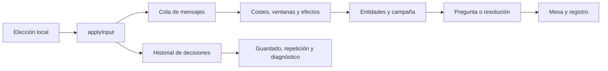

# 15 · Auditoría funcional e ingeniería inversa de la aplicación de referencia

> Orden de trabajo actualizado: consolidar primero Brethren of Ash según la
> [auditoría de cierre específica](16-auditoria-cierre-brethren-of-ash.md).
> El visor de los mazos de plan y acto se ha implementado después de esta comparación.

**Fecha:** 17 de octubre de 2026.  
**Referencia examinada:** `D:\referencia\ArkhamHorror-main`.  
**Proyecto comparado:** `D:\Arkham`, sobre `9535ac2dc8cbc41ca14d1dda952018e63b7e6f65`, incluyendo los cambios locales presentes durante la revisión.  
**Alcance:** juego local y solitario con uno o varios investigadores, contenido, reglas, mesa, mazos, campañas, herramientas y distribución. **El multijugador online queda excluido por decisión del propietario.**

Este documento sustituye como inventario comparativo actualizado a [10 · Funcionalidades de la mesa](10-funcionalidades-mesa.md). Contiene **110 oportunidades** de implementación o ampliación, un inventario del contenido encontrado y propuestas de trabajo con criterios de aceptación. El [anexo CSV](15-backlog-referencia-2026-10-17.csv) contiene las mismas 110 oportunidades para filtrarlas y planificarlas.

El catálogo distingue **47 funciones ausentes** y **63 ampliaciones de funciones parciales**. Hay **25 propuestas P1**, 71 P2 y 14 P3. Son capacidades de distinto tamaño, no 110 tareas del mismo esfuerzo.

## 1. Resultado de la comparación

La referencia aporta tres grandes fuentes de valor para nuestro proyecto:

1. **Funciones prácticas alrededor de la partida:** biblioteca de campañas guardadas, importación y exportación, repetición visual, historial consultable, registro enriquecido y herramientas para reproducir o corregir fallos. Son útiles incluso jugando completamente en local.
2. **Un motor con un vocabulario de reglas mucho mayor:** costes compuestos, límites con distintas duraciones, efectos en varias zonas, instancias de carta, modificadores consultables, fichas especiales y mecánicas específicas de expansiones. Es la parte que permite ampliar de verdad el catálogo.
3. **Contenido organizado como módulos:** campañas oficiales, variantes Return to, escenarios independientes, desafíos de investigador y contenido de aficionados. Interesa estudiar sus preparaciones, conexiones, transiciones, efectos y pruebas para escribir nuestras implementaciones.

Nuestra aplicación ya tiene una base considerable: Brethren of Ash con sus tres escenarios, cinco investigadores de 2026, construcción y mejora de mazos, historia, decisiones sobre la mesa, reacciones, deshacer y pruebas de habilidad interactivas. **No conviene tratar todo lo que hace la referencia como una función nueva.** La siguiente inversión más aprovechable es completar la experiencia local y preparar el motor para añadir contenido por lotes.

### Diez propuestas para empezar

| Orden | Propuesta | Motivo |
|---|---|---|
| 1 | Biblioteca de partidas y campañas locales, F001 | Ahora solo hay una partida y una campaña activas almacenadas con claves fijas. |
| 2 | Exportación e importación propias, F002–F004 | Permiten respaldar, trasladar y recuperar campañas sin cuentas ni servidor. |
| 3 | Registro con cartas, causas y filtros, F034–F036 | Hace comprensible por qué ha ocurrido un efecto y facilita revisar errores. |
| 4 | Paquete de diagnóstico reproducible, F089 | Tenemos semilla y decisiones: falta convertirlas en una herramienta de trabajo. |
| 5 | Repetición visual, F006 | Aprovecha el historial determinista que ya utilizamos para deshacer. |
| 6 | Desglose de experiencia y cambios de campaña, F042–F043 | Mejora mucho la pantalla entre escenarios sin añadir una expansión. |
| 7 | Correcciones locales con historial, F090–F092 | Evita perder una campaña ante una incidencia y ayuda a desarrollar cartas. |
| 8 | Ordenación visual y selección múltiple, F026–F028 | Reduce decisiones repetitivas y hace más claras búsquedas y repartos. |
| 9 | Explicar modificadores y estados, F017 y F071 | Acerca la automatización del motor al jugador. |
| 10 | Primer paquete nuevo: Night of the Zealot, F099 | Es una ampliación acotada con la que probar el proceso de incorporación de contenido. |

Este orden es una recomendación de producto. Las dependencias técnicas de las secciones 7 y 8 prevalecen cuando una propuesta requiera cambiar el modelo de estado.

## 2. Método, evidencias y límites de la revisión

Se ha hecho una revisión estática dirigida del código, siguiendo rutas de interfaz, componentes, tipos, registros de contenido, manejadores del motor, pruebas y documentación. Las referencias `[R…]` enlazan a archivos concretos de la aplicación estudiada; `[N…]` enlazan a nuestro código. Las afirmaciones sobre ausencia se basan en nuestras rutas, tipos, registros y puntos de entrada actuales, no solo en los documentos de planificación.

Se han inspeccionado especialmente:

- Creación, listado, carga, exportación y repetición de partidas.
- Mesa, pruebas, elecciones, pilas, bolsa, ajustes y atajos.
- Flujo de campañas, registro, experiencia, mejoras y escenarios independientes.
- Importadores de mazos, restricciones, reimpresiones y personalizaciones.
- Cola de mensajes, ventanas, costes, modificadores, ubicaciones y límites.
- Catálogo, módulos de campañas, contenido de aficionados y editor de cartas.
- Herramientas de depuración, almacenamiento, recursos locales y pruebas.

**Verificación ejecutada en nuestro proyecto:** `node node_modules/vitest/vitest.mjs run`: **21 archivos de prueba y 212 pruebas aprobadas**. `pnpm test` no llegó a ejecutar las pruebas porque el gestor intentó crear un enlace de su almacén fuera del espacio permitido; se usó el ejecutable de Vitest ya instalado. No se cambiaron las dependencias.

**Límite de la evidencia:** no se ha compilado ni ejecutado el backend Haskell de referencia, ni se han jugado todas sus campañas. Sus registros y manejadores acreditan que existe una implementación, pero no demuestran que cada carta o resolución sea correcta. Tampoco se afirma haber leído línea por línea sus miles de módulos. Los casos marcados como experimentales conservan esa condición; el resto tampoco se presenta como una certificación de reglas.

### Tamaño e inventario medidos

Las siguientes cifras proceden de contar archivos de esta copia local. **Son archivos de implementación, no cartas únicas, escenarios certificados ni medidas de calidad.** Las variantes, los auxiliares y las pruebas tienen su propia estructura.

| Área de referencia | Recuento |
|---|---:|
| Archivos `.hs` bajo `backend/arkham-api/library/Arkham` | 9.267 |
| Bajo `Asset/Assets` | 1.177 |
| Bajo `Event/Events` | 519 |
| Bajo `Skill/Cards` | 157 |
| Bajo `Investigator/Cards` | 98 |
| Bajo `Treachery/Cards` | 761 |
| Bajo `Enemy/Cards` | 700 |
| Bajo `Location/Cards` | 1.303 |
| Bajo `Scenario/Scenarios` | 157 |
| Bajo `Campaign/Campaigns`, incluidos auxiliares anidados | 32 |
| Bajo `Homebrew` | 1.688 |
| Archivos de pruebas backend terminados en `Spec.hs` | 406 |
| Pruebas frontend terminadas en `.test.mjs` | 23 |
| Entradas en el manifiesto principal de campañas | 13 |
| Entradas en el manifiesto de historias paralelas y desafíos | 19 |
| Directorios de contenido de aficionados, en backend y frontend | 14 |

En nuestro JSON de caja básica hay **104 definiciones**, incluidas **5 de investigador** y **22 cartas de nivel superior a cero**. Se registra una campaña principal, Brethren of Ash, con tres escenarios. [N15] [N16] [N31]

### Cómo leer el catálogo

- **Ausente:** no aparece un equivalente funcional en los puntos de entrada actuales.
- **Parcial:** existe una base o un caso concreto; se describe exactamente lo que falta.
- **Experimental:** la referencia lo oculta o condiciona mediante indicadores de desarrollo o beta, o requiere una validación adicional.
- **P1:** siguiente bloque de mejoras para la experiencia local.
- **P2:** crecimiento del motor o del contenido después de estabilizar ese bloque.
- **P3:** opción especializada que conviene abordar cuando haya una necesidad concreta.
- **S / M / L / XL:** esfuerzo relativo pequeño, medio, grande o de varios hitos. No son estimaciones de calendario. Los tamaños L/XL deben dividirse antes de implementarse.

Las propuestas de adaptación y sus criterios de aceptación son conclusiones de esta auditoría. No se atribuyen a la referencia decisiones como usar IndexedDB, nuestro formato de guardado o nuestros paquetes TypeScript.

## 3. Funciones que ya tenemos y que conviene conservar

| Función | Estado real comprobado | Evidencia propia |
|---|---|---|
| Uno a cuatro investigadores controlados en local | Selección de equipo y turnos en el navegador. No requiere multijugador online. | [N09] [N07] |
| Campaña Brethren of Ash | Spreading Flames, Smoke and Mirrors y Queen of Ash, con registro y continuación. | [N14] [N16] |
| Cinco investigadores de 2026 | Habilidades y comportamiento registrados; no es correcto seguir marcándolos todos como pendientes. | [N02] [N32] |
| Mano inicial y mulligan | Decisiones interactivas de preparación. | [N03] [N24] |
| Acciones, amenazas y enemigos | Incluye masivo y esquivo; patrulla y enjambre requieren ampliación. | [N01] [N03] |
| Reacciones | Ya existe `Reactions` y reacciones de cartas e investigadores; falta cobertura más general del tiempo de juego. | [N02] [N03] |
| Pruebas ST.1–ST.8 y probabilidad | Panel interactivo, compromiso, fichas y estimación de éxito. Ampliar a nuevas fichas exige ampliar el cálculo. | [N21] [N05] |
| Revelar dos fichas y escoger | Caso de Mask of Silenus. No hay que empezar esta mecánica desde cero. | [N03] [N32] |
| Sellado | Existe el caso de Premonition; no equivale a un sistema general de sellado por entidad. | [N03] |
| Ordenar cartas | `ArrangeCards` ya permite devolver cartas arriba o abajo; falta una interfaz de composición visual completa. | [N03] [N24] |
| Cartas debajo | `Location.beneath` y su indicador existen para encuentros bajo localizaciones. Falta el modelo general para otras entidades. | [N01] [N22] |
| Mazos propios e importación de ArkhamDB | Editor, filtros básicos, validación y elección al crear campaña. | [N11] [N13] |
| Experiencia, trauma, recompensas y compra | Ya se guardan y aplican entre escenarios. | [N12] [N14] |
| Deshacer | Paso, acción, turno y ronda, mediante repetición determinista. | [N07] [N08] |
| Atajos y navegación del mapa | Atajos básicos; zoom, arrastre, ajuste y gestos táctiles del tablero. | [N33] [N34] |
| Imágenes y textos con alternativas | Imágenes externas, escaneos locales opcionales y plantillas de respaldo. | [N18] [N19] [N35] |

Los documentos 05, 08 y algunas filas del 10 conservan marcas antiguas. Por ejemplo, el 10 todavía menciona ordenar cartas como pendiente y otras secciones del mismo documento describen `ArrangeCards`; el 08 ya explica masivos mientras la hoja de ruta sigue marcándolos como futuros. Para planificar deben prevalecer el código y esta auditoría.

## 4. Ingeniería inversa: qué hace la referencia y cómo aprovecharlo

### 4.1. De una decisión a la siguiente

La interfaz de referencia recibe un estado con entidades y preguntas, convierte la elección en una petición y representa el siguiente estado. El backend distribuye mensajes a campaña, escenario y entidades; también procesa comportamientos de cartas en mano, descarte y otras zonas. Costes, ventanas y modificadores son conceptos independientes. [R06] [R20] [R41] [R42] [R43] [R49]

Nuestro flujo es similar en lo esencial: `applyInput` toma una elección, encola sus mensajes y ejecuta `handle` hasta la próxima pregunta o resolución. El motor es puro y la web lo llama directamente. Esta similitud permite estudiar las reglas de referencia sin adoptar Haskell, Yesod, cuentas o transporte por WebSocket. [N06] [N07]

El diagrama representa la adaptación propuesta sobre nuestro flujo. Costes y ventanas ya existen parcialmente en nuestro motor, pero todavía no como subsistemas con toda la generalidad de la referencia.

### 4.2. Definición impresa frente a instancia de carta

La referencia distingue la definición de una carta de la copia concreta que circula por las zonas. Usa identidad de instancia y metadatos para personalizaciones, caras, transformaciones o sellos; la colocación también es un tipo propio. [R35] [R37] [R56]

Nosotros tenemos identificadores para apoyos, enemigos y traiciones en juego, pero mano, mazo y descarte son listas de `CardCode`. Esto funciona para el contenido actual, aunque complica distinguir dos copias del mismo título cuando una tiene información propia. La ampliación útil es introducir gradualmente instancias también fuera de juego, sin confundir código de carta, código de impresión e identidad de copia. [N01]

### 4.3. Reglas pequeñas que se combinan

La referencia expresa selección de objetivos con matchers, restricciones con criterios, pagos con costes, cambios con modificadores y oportunidades de reacción con ventanas. Sus límites pueden ser por turno, fase, prueba, búsqueda o campaña. [R41] [R42] [R44] [R45] [R46]

Nuestro registro de comportamiento ya separa los datos del estado de las funciones de las cartas. El siguiente paso es extraer vocabulario común allí donde varias cartas lo necesiten: no trasladar los cientos de constructores de golpe. Un buen primer caso sería implementar una carta nueva con un coste compuesto y un efecto hasta el final de una prueba, dejando una utilidad común y su prueba de regresión. [N02]

### 4.4. La campaña es un flujo, no solo una lista

`CampaignStep` contempla prólogos, escenarios, interludios, epílogos, puntos de control, mejoras, historias intercaladas y acciones específicas de campaña. La continuación conserva a qué paso debe regresar. También existen estados de registro configurables para empezar más adelante en una campaña. [R22] [R24] [R25] [R26]

Nuestra campaña avanza incrementando `scenarioIndex`. Es suficiente para la campaña inicial; las bifurcaciones, campañas entrelazadas y escenarios insertados necesitan un modelo de pasos y una continuación explícita. Las notas y valores actuales se pueden conservar como parte del registro, ampliando su tipado cuando el contenido lo pida. [N14] [N15]

### 4.5. La historia de la partida sirve para varias cosas

La referencia tiene repetición visual, deshacer por límites y por paso, historial de actividad y exportación de registro. Son funciones distintas: un resumen de lo sucedido no sustituye al estado necesario para deshacer, y una transcripción no sustituye a una partida importable. [R06] [R07] [R08] [R09]

Nosotros ya guardamos estado inicial, decisiones y marcas. Podemos crear la repetición en modo de lectura y añadir puntos de control para evitar reconstruir desde el principio en cada salto. Al deshacer, actualmente se recorta la lista de decisiones; recuperar el futuro exige conservar una rama o un búfer separado. [N07] [N08]

### 4.6. Los módulos de contenido aportan una especificación ejecutable

Un escenario de referencia reúne mapa, cartas, preparación, bolsa, efectos de símbolos y resoluciones; las cartas tienen su comportamiento separado. Los módulos homebrew añaden identificadores con espacio de nombres, textos, tokens, logros y escenarios desde su carpeta. [R59] [R60] [R61]

Lo aprovechable es extraer fichas de implementación: requisitos de preparación, conjuntos de encuentro, distribución y conexiones, estados de campaña consultados, efectos y casos de prueba. Nuestros `registerCampaign` y `registerScenario` ya son la base para ello. Según las convenciones del proyecto, la integración se escribe con código propio. [N02] [N15] [N16] [N36]

## 5. Catálogo de oportunidades

En la columna «Implementación y comprobación» se describe el resultado que debería poder revisar un usuario o un desarrollador. Las referencias incluyen tanto la función encontrada como la base propia cuando existe.

### A. Guardados, biblioteca y repetición

| ID | Propuesta | Estado | Prioridad | Esfuerzo | Implementación y comprobación | Evidencia |
|---|---|---|---|---|---|---|
| F001 | Biblioteca de partidas y campañas locales | Ausente | P1 | L | Identificador de partida, nombre, fecha, escenario y equipo; abrir dos campañas distintas sin que una sustituya a la otra. | [R03] [N07] |
| F002 | Exportar una partida o campaña completa | Ausente | P1 | M | Descargar un archivo propio con campaña, estado, semilla, decisiones y versión; poder reconstruir la misma pregunta pendiente. | [R06] [R05] [N07] |
| F003 | Importar un guardado con vista previa | Ausente | P1 | M | Mostrar campaña, investigadores y compatibilidad antes de incorporarlo a la biblioteca; rechazar un archivo inválido conservando los guardados existentes. | [R05] [N07] |
| F004 | Compatibilidad y migración de guardados | Parcial | P1 | L | Ya existe `engineVersion`; añadir validación, versión de formato y contenido, migraciones explícitas y aviso cuando una repetición no sea compatible. | [R05] [R35] [N01] [N07] |
| F005 | Archivo local de campañas terminadas | Ausente | P2 | M | Separar activas y finalizadas, consultar resultados y cargar una repetición; archivar no debe borrar el historial. | [R03] [R69] [N07] |
| F006 | Repetición visual de la partida | Parcial | P1 | L | Reutilizar la reproducción de entradas para mostrar inicio, anterior, siguiente, pausa y reproducción automática sin cambiar la partida activa. | [R07] [N07] [N08] |
| F007 | Saltar a un punto del historial | Parcial | P2 | M | Elegir una decisión o entrada de registro y abrir su estado; distinguir claramente observarlo de volver a jugar desde allí. | [R06] [R10] [N08] |
| F008 | Deshacer fase y reiniciar escenario | Parcial | P2 | M | Añadir límites explícitos de fase y un punto de inicio del escenario, además de los cuatro niveles actuales. | [R06] [N08] |
| F009 | Conservar una variante al volver atrás | Parcial | P2 | L | Crear una copia desde un paso conservando el historial original. Es una adaptación local propuesta a partir de repetición, exportación y deshacer, no una función de ramas acreditada en la referencia. | [R05] [R07] [N07] |
| F010 | Puntos de control y almacenamiento escalable | Parcial | P2 | L | Conservar entradas compactas y estados periódicos; medir saltos en una campaña larga. Evaluar IndexedDB al añadir varias campañas. | [R69] [R70] [N07] |

### B. Mesa, información y preferencias

| ID | Propuesta | Estado | Prioridad | Esfuerzo | Implementación y comprobación | Evidencia |
|---|---|---|---|---|---|---|
| F011 | Consultar las dos caras de una carta | Parcial | P1 | M | Ya mostramos localizaciones por su cara activa; añadir giro explícito en la inspección y resolver correctamente cartas con reverso propio, sin revelar información oculta por defecto. | [R35] [R74] [N18] [N35] |
| F012 | Cartas debajo de cualquier entidad | Parcial | P2 | L | Generalizar `beneath` a apoyos, investigadores, actos y planes; contador y visor que respeten las cartas boca abajo. | [R14] [R37] [N01] [N22] |
| F013 | Zona de vinculadas y cartas fuera de juego | Ausente | P2 | L | Diferenciar vinculadas, apartadas, exiliadas y retiradas; consultar cada zona sin mezclarla con descartes. | [R06] [R37] [N01] |
| F014 | Mazos y pilas auxiliares de escenario | Ausente | P2 | L | Declarar varias pilas con nombre, reverso, contador y descarte; una acción debe apuntar a la pila correcta. | [R12] [R21] [N01] |
| F015 | Contadores generales sobre las entidades | Parcial | P2 | L | Ya hay perdición, usos y contadores concretos; representar tipos simultáneos con sus nombres y explicar cuáles cuentan para un umbral. | [R52] [R37] [N01] [N23] |
| F016 | Fichas selladas visibles en su carta | Parcial | P2 | M | Convertir el caso de Premonition en un visor de sellos por entidad; liberar una ficha debe actualizar carta y bolsa. | [R75] [N03] |
| F017 | Panel «por qué tiene este valor» | Parcial | P1 | M | Desglosar valor base, bonificaciones, penalizaciones, fuente y duración para una prueba o entidad. El valor mostrado debe coincidir con el cálculo del motor. | [R15] [R44] [N05] [N21] |
| F018 | Vista simultánea de investigadores | Ausente | P2 | M | Añadir una alternativa a las pestañas para comparar zonas de juego y manos en solitario con varios investigadores. | [R13] [R17] [N10] [N23] |
| F019 | Agrupar permanentes y cartas sin efecto activo | Ausente | P2 | M | Recogerlas en una pila opcional, recuperando una carta si una elección necesita señalarla. | [R13] [N23] |
| F020 | Girar y reorganizar el mapa | Parcial | P3 | L | Ya tenemos zoom y desplazamiento; añadir rotación y posiciones visuales propias, conservando las conexiones y las coordenadas lógicas. | [R12] [N22] [N34] |
| F021 | Preferencias globales y por partida | Parcial | P1 | M | Idioma y tapete ya se recuerdan; añadir ajustes tipados con valor global y anulación local para presentación, animaciones y preguntas. | [R16] [R17] [N07] |
| F022 | Configurar la carta robada destacada | Parcial | P1 | S | Ofrecer todos los robos, solo los relevantes o desactivado, sin modificar la resolución del robo. | [R17] [R06] [N10] |
| F023 | Sonido y avisos de cambio de fase | Ausente | P3 | M | Avisos opcionales con control de volumen o silencio; respetar preferencias del navegador y no bloquear las decisiones. | [R06] [R12] [N10] |
| F024 | Perfiles de atajos y ayuda visible | Parcial | P2 | M | Conservar los atajos actuales y añadir un mapa centralizado, ayuda y un perfil alternativo; los menús deben mostrar las teclas reales. | [R73] [N33] |
| F025 | Notificaciones breves y errores de guardado visibles | Parcial | P1 | M | Confirmar importación, exportación y compra; si falla el almacenamiento, mostrarlo. Hoy los errores de persistencia se absorben en `catch`. | [R06] [R17] [N07] |

### C. Preguntas, búsquedas y reparto

| ID | Propuesta | Estado | Prioridad | Esfuerzo | Implementación y comprobación | Evidencia |
|---|---|---|---|---|---|---|
| F026 | Ordenación visual de cartas | Parcial | P1 | M | Componer el orden completo, corregir posiciones y confirmar una vez; el motor conserva `ArrangeCards`, evitando una decisión visible por cada colocación. | [R19] [N03] [N24] |
| F027 | Selecciones de N o hasta N cartas | Parcial | P1 | M | Mostrar seleccionadas, límite y candidatas; aplicar al confirmar y verificar el conjunto completo en el motor. | [R20] [N01] [N24] |
| F028 | Repartir cantidades con un formulario | Parcial | P1 | M | Reutilizar la lógica actual de daño y pagos para preparar el reparto de una vez; mostrar total pendiente, máximos y destinos válidos. | [R20] [N03] [N24] |
| F029 | Asistentes de decisiones de historia | Parcial | P2 | M | Elección en varios pasos con contexto, previsualización y vuelta atrás antes de confirmar; los efectos se aplican una sola vez. | [R20] [N25] |
| F030 | «Pasar estas ventanas» | Ausente | P2 | M | Pasar las oportunidades actuales de reacción o rápidas de forma explícita, sin omitir elecciones obligatorias ni extender el pase a ventanas futuras diferentes. | [R06] [N02] [N03] |
| F031 | Preferencias de automatización por carta | Ausente | P3 | L | Decidir qué oportunidades opcionales preguntar siempre o automatizar; guardar el alcance de la preferencia y permitir volver al modo manual. | [R18] [N02] |
| F032 | Selector reutilizable de reservas de cartas | Ausente | P2 | L | Mostrar candidatas y elegidas para mazos auxiliares como corazonadas o cartas bajo Stick to the Plan; no confundir al Joe antiguo con el de 2026. | [R21] [N01] |
| F033 | Respuestas estructuradas para preguntas específicas | Parcial | P2 | L | Extender el único `chooseOne` actual con respuestas tipadas de conjunto, orden y cantidades; mantener objetivos sobre la mesa y serialización. | [R20] [N01] [N06] |

### D. Registro e historial consultable

| ID | Propuesta | Estado | Prioridad | Esfuerzo | Implementación y comprobación | Evidencia |
|---|---|---|---|---|---|---|
| F034 | Cartas e iconos dentro del registro | Parcial | P1 | M | Mantener claves i18n y añadir referencias tipadas a entidades, cartas, fichas y cantidades; inspeccionar una carta desde su entrada. | [R10] [R11] [N01] [N20] |
| F035 | Filtros y búsqueda en el registro | Parcial | P1 | M | Propuesta propia sobre el registro estructurado y paginado de referencia: filtrar por investigador, ronda y tipo y buscar en todo el historial. No se ha encontrado esa búsqueda general en su panel. Aquí el lateral presenta las últimas 120 entradas. | [R10] [R11] [N20] |
| F036 | Relación entre acción y consecuencias | Parcial | P1 | L | Agrupar coste, prueba, resultado y reacciones bajo una causa; poder entender de dónde proviene un daño o una pérdida de recursos. | [R10] [R11] [N01] |
| F037 | Exportar una transcripción legible | Ausente | P1 | M | Descargar texto en el idioma activo, de toda la partida o de un escenario; incluir nombres y resultados de forma comprensible. | [R09] [N20] |
| F038 | Exportar registro estructurado y traza técnica | Ausente | P2 | M | Producir datos para análisis y diagnóstico, diferenciándolos del guardado importable y de la transcripción. | [R09] [R10] [N01] |
| F039 | Resumen de actividad por turno, fase y ronda | Ausente | P2 | M | Consultar cartas jugadas, pistas, pruebas, enemigos y recursos de cada investigador; reconstruirlo correctamente tras deshacer. | [R08] [N01] |
| F040 | Volver al estado anterior a una entrada | Ausente | P2 | M | Vincular una entrada a su índice de decisión y permitir abrir la repetición allí; para deshacer, crear un punto recuperable. | [R10] [R06] [N07] |
| F041 | Registro extenso con renderizado incremental | Parcial | P2 | M | Poder consultar una campaña completa manteniendo fluidez; conservar el desplazamiento al abrir grupos y añadir nuevas entradas. | [R10] [R11] [N20] |

### E. Campañas y variantes de partida

| ID | Propuesta | Estado | Prioridad | Esfuerzo | Implementación y comprobación | Evidencia |
|---|---|---|---|---|---|---|
| F042 | Desglose de experiencia por origen | Parcial | P1 | M | Separar victoria, bonificaciones y pérdidas por investigador; mostrar el total ganado y gastado de forma verificable. | [R28] [R29] [N12] [N14] |
| F043 | Historial de cambios de la bolsa | Parcial | P1 | M | Ya añadimos fichas de campaña; guardar antes, después y causa, incluyendo retiradas y reemplazos cuando el contenido los necesite. | [R27] [R23] [N01] [N14] |
| F044 | Campañas con pasos y bifurcaciones | Parcial | P2 | XL | Sustituir la progresión exclusivamente por índice por pasos serializables, preservando el recorrido actual y sus guardados. | [R22] [N14] [N15] |
| F045 | Historias paralelas entre escenarios | Ausente | P2 | L | Insertar un escenario, pagar su coste por investigador y regresar al paso de campaña correspondiente con sus recompensas. | [R22] [R26] [N14] |
| F046 | Modo independiente de un escenario | Ausente | P2 | L | Elegir escenario, experiencia inicial y antecedentes necesarios sin jugar todos los anteriores; validar sus ajustes. | [R04] [R25] [N09] [N14] |
| F047 | Empezar una campaña desde un escenario posterior | Ausente | P2 | L | Asistente de registro previo con condiciones, notas y conjuntos; generar un estado coherente para el punto de entrada elegido. | [R24] [N14] [N15] |
| F048 | Sustituir o incorporar investigadores entre escenarios | Parcial | P2 | L | Ya identificamos muertos y enloquecidos; permitir un sustituto legal, con su propio mazo y registro, siguiendo la campaña. | [R29] [R23] [N12] [N14] |
| F049 | Registro con conjuntos, contadores y secciones | Parcial | P2 | L | Ampliar notas, tachados y valores a conjuntos registrados y datos específicos sin codificar cada campaña en la pantalla general. | [R23] [R24] [N01] [N12] |
| F050 | Parámetros y modos de una campaña | Ausente | P2 | M | Declarar modo completo, parcial y variantes disponibles por contenido; solo ofrecer opciones implementadas. | [R04] [R22] [N15] |
| F051 | Variantes Return to | Ausente | P2 | XL | Selección de conjuntos y cambios de preparación con identidad de variante estable; compartir las reglas comunes con la campaña base. | [R04] [R61] [N15] |
| F052 | Lecturas de tarot | Ausente | P3 | L | Lecturas, orientación y alcance global o individual; registrar efectos activos y su duración. No confundirlo con la ranura de cartas Tarot. | [R64] [R04] [N01] |
| F053 | Ultimátums, dones y otras variantes declaradas | Ausente | P3 | L | Activar opciones compatibles por campaña con sus reglas y registro; mostrar qué cambia antes de empezar. | [R65] [R16] [N15] |
| F054 | Logros locales persistentes | Ausente | P3 | L | Detección por reglas de campaña y listas acumulativas entre partidas; guardar el progreso en un perfil local sin cuenta online. | [R66] [R60] [N14] |
| F055 | Superposiciones de campaña sobre una historia paralela | Ausente | P3 | L | Declarar disponibilidad y coste de entrada según el registro; aplicar las reglas específicas en sus cartas o escenarios, sin duplicar todo el escenario. | [R76] [R22] [N15] |

### F. Catálogo y mazos

| ID | Propuesta | Estado | Prioridad | Esfuerzo | Implementación y comprobación | Evidencia |
|---|---|---|---|---|---|---|
| F056 | Navegador general de cartas | Parcial | P2 | M | Separar consulta del catálogo de la edición de un mazo; vista en lista o imágenes y navegación por caja, ciclo y conjunto. | [R34] [N11] |
| F057 | Filtros por rasgo, coste, iconos y ranura | Parcial | P2 | M | Ampliar nombre, clase, tipo y nivel cero actuales; combinar filtros y mostrar el recuento que dejaría cada selección. | [R34] [R77] [N11] |
| F058 | Importar mazos desde archivo o texto | Ausente | P1 | M | Admitir JSON y pegado con vista previa, investigador y cartas descartadas por incompatibilidad; no exigir red. | [R30] [R29] [N11] [N13] |
| F059 | Importar enlaces públicos de arkham.build | Ausente | P2 | M | Normalizar los formatos soportados y explicar enlaces incorrectos o privados; conservar el origen del mazo. | [R30] [R29] [N13] |
| F060 | Mejorar desde una nueva versión de un mazo importado | Parcial | P2 | L | Comparar el mazo propuesto con el de campaña, calcular compras y cambios y validar XP antes de aplicarlo. | [R29] [N14] |
| F061 | Lista de tabú por versión | Ausente | P2 | L | Persistir la lista elegida, ajustar reglas y costes y mostrar la versión en catálogo, mazo y campaña. | [R32] [R29] [N01] [N13] |
| F062 | Colección disponible y reserva legal de cartas | Parcial | P2 | L | Declarar cajas permitidas y límites relevantes; distinguir recompensas ganadas, cartas implementadas y cartas disponibles. | [R31] [R34] [N13] |
| F063 | Reimpresiones y equivalencias de cartas | Parcial | P2 | L | Identidad canónica para límites y búsquedas, manteniendo impresión y arte elegidos; no asumir que todo código distinto es una carta distinta. | [R31] [R35] [R76] [N13] [N18] |
| F064 | Personalizaciones compradas con experiencia | Ausente | P2 | XL | Casillas, opciones y XP de cartas Customizable; guardar las elecciones e incorporarlas a coste, ranuras y comportamiento. | [R33] [R29] [N01] |
| F065 | Reglas de construcción más expresivas | Parcial | P2 | L | Ampliar clase y nivel a rasgos, excepciones y ajustes propios del investigador; probarlas con el primer investigador que las necesite. | [R31] [R35] [N13] |
| F066 | Debilidad aleatoria según contexto | Parcial | P2 | M | Ya añadimos una debilidad; ampliar candidatos por modo, equipo, colección y tabú, evitando que una reimpresión aumente su probabilidad. | [R31] [N13] |
| F067 | Variantes de investigador y exclusivas alternativas | Ausente | P2 | L | Seleccionar caras o exclusivas compatibles y conservar la variante; distinguir variantes antiguas de investigadores de sus versiones 2026. | [R35] [R74] [N13] [N32] |
| F068 | Mazos auxiliares propios de cartas e investigadores | Ausente | P2 | L | Reservas con nombre y reglas de construcción o acceso, como corazonadas y mercado; enseñar su contenido permitido y sus acciones. | [R21] [R32] [N01] |

### G. Motor de reglas y extensibilidad

| ID | Propuesta | Estado | Prioridad | Esfuerzo | Implementación y comprobación | Evidencia |
|---|---|---|---|---|---|---|
| F069 | Instancias de carta en todas las zonas | Parcial | P2 | XL | Mantener identidad y metadatos de cada copia al pasar entre mazo, mano, descarte y juego; migrar listas actuales de códigos. | [R35] [R56] [N01] |
| F070 | Vocabulario común para selección y restricciones | Parcial | P2 | L | Consultas combinables por rasgo, zona, distancia y controlador; evitar que cada carta reescriba sus filtros y restricciones. | [R45] [N02] [N04] |
| F071 | Modificadores con fuente, alcance y duración | Parcial | P2 | L | Reunir efectos temporales y constantes bajo un cálculo común que también pueda explicar la interfaz; expirar por el límite correcto. | [R44] [N02] [N05] |
| F072 | Costes compuestos y pagos registrados | Parcial | P2 | L | Formalizar combinaciones de acciones, recursos, descarte, usos, agotamiento y pagos de grupo; comprobar la legalidad y guardar el pago realizado. | [R42] [R43] [N03] [N04] |
| F073 | Ventanas generales de cuándo, si y después | Parcial | P2 | XL | Ampliar los disparadores existentes a eventos con temporización, contexto y cancelación definidos; preservar el orden forzado y opcional. | [R41] [N01] [N03] |
| F074 | Límites por turno, fase, prueba y campaña | Parcial | P2 | M | Extender los límites actuales por ronda o partida; identificar también el ámbito de grupo, jugador o título y el número máximo de usos. | [R46] [N01] |
| F075 | Efectos de cartas en mano, descarte y búsqueda | Parcial | P2 | L | Generalizar los casos ya soportados en `handReactions` y debilidades; activar solo los efectos válidos para cada zona. | [R49] [N02] |
| F076 | Vinculadas, miríada, excepcional, investigadas y exilio | Parcial | P2 | XL | Incorporar estas familias por lotes, incluidas reglas de mazo, experiencia y salida de juego; `Permanent` ya tiene soporte propio. | [R36] [R42] [N01] [N13] |
| F077 | Patrulla y movimiento enemigo más general | Parcial | P2 | L | Añadir destino por criterio y reglas de movimiento; reutilizar caminos y decisiones del jefe existentes para cazadores. | [R47] [N01] [N05] |
| F078 | Enjambres | Ausente | P2 | L | Modelar anfitrión y miembros, daño, derrotas y devolución de cartas, con representación de pila que conserve sus identidades. | [R36] [R37] [R47] [N01] |
| F079 | Hidden, Veiled y Haunted | Ausente | P2 | L | Implementar estas reglas según su contenido; preservar información oculta en zonas, preguntas y registro. | [R36] [R37] [R48] [N01] |
| F080 | Bendición y maldición en la bolsa | Ausente | P2 | L | Ampliar los tipos reales de ficha, su reserva, revelaciones adicionales, retorno y consumo; actualizar probabilidades. Tener imágenes no implementa estas reglas. | [R38] [R40] [N01] [N17] |
| F081 | Helada y fichas especiales de campaña | Ausente | P2 | L | Añadir cadenas de revelación y condiciones especiales de fallo; separar fichas oficiales de fichas con espacio de nombres. | [R38] [R40] [N01] |
| F082 | Sellado y liberación generales | Parcial | P2 | L | Sellar por criterio o elección, ligar ficha a una entidad y liberarla al cambiar su estado; mantener el caso actual de Premonition. | [R36] [R75] [N03] |
| F083 | Estrategias generales de revelación múltiple | Parcial | P2 | L | Generalizar revelar N y elegir M, resolver todas o ignorar algunas; probar combinaciones con fichas que obligan a revelar más. | [R39] [N03] [N21] |
| F084 | Colocaciones, anexos y control de cartas | Parcial | P2 | XL | Separar propietario, controlador, ubicación y anfitrión; soportar anexos a más entidades y limpiar referencias al desaparecer el anfitrión. | [R37] [R50] [N01] |
| F085 | Más tipos de carta persistente y transformaciones | Parcial | P2 | XL | Eventos que permanecen, historias con reglas, cartas que cambian de tipo o cara y entidades vinculadas a la misma instancia. | [R37] [R35] [N01] |
| F086 | Nuevas acciones declaradas por contenido | Parcial | P2 | L | Extender acciones y sus costes sin añadir excepciones a cada pantalla; primeros casos: explorar, escanear o exponer. | [R59] [R36] [N01] [N04] |
| F087 | Estado común para llaves, inundación y vehículos | Ausente | P3 | XL | Crear subsistemas cuando se incorpore su campaña; cada uno debe declarar acciones, efectos, guardado y representación. | [R37] [R48] [R12] [N01] |
| F088 | Bolsas auxiliares y reservas compartidas | Ausente | P3 | L | Mantener bolsas de infestación o depredación distintas del caos, con sus fichas, apartadas y revelación actual. | [R78] [R79] [N01] |

### H. Diagnóstico, corrección y calidad

| ID | Propuesta | Estado | Prioridad | Esfuerzo | Implementación y comprobación | Evidencia |
|---|---|---|---|---|---|---|
| F089 | Paquete reproducible de incidencia | Parcial | P1 | M | Exportar versión, contenido, base, decisiones, pregunta y error; un desarrollador debe poder llegar al mismo fallo en local sin servicios externos. | [R06] [R05] [N06] [N07] |
| F090 | Corrección manual de fichas y valores | Ausente | P1 | L | Modo de herramientas para ajustar daño, horror, pistas, recursos y perdición; registrar cada corrección y permitir deshacerla. | [R52] [R06] [N07] |
| F091 | Corregir cartas y su ubicación | Ausente | P2 | L | Mover, agotar, preparar, descartar o añadir cartas mediante operaciones validadas, con vista previa y causa registrada. | [R50] [R12] [N01] |
| F092 | Editar registro y bolsa de campaña | Ausente | P2 | L | Cambios tipados en notas, trauma, experiencia y composición de bolsa; conservar el estado anterior y poder reproducir la corrección. | [R24] [R27] [R50] [N14] |
| F093 | Explorador de entidades y referencias rotas | Ausente | P2 | M | Enumerar todas las entidades, incluso las que no se dibujan, señalando anfitriones inexistentes y opciones sin objetivo accesible. | [R50] [N01] [N07] |
| F094 | Herramientas de escenario y elección de ficha | Ausente | P2 | M | En modo de prueba, preparar estados concretos y forzar una ficha; una prueba normal debe seguir usando el RNG del motor. | [R53] [R12] [N06] |
| F095 | Inspeccionar cola, pregunta y efectos pendientes | Ausente | P2 | M | Visor de solo lectura con origen y tipos; adjuntarlo al diagnóstico cuando se alcance el límite de mensajes o no aparezca una decisión esperada. | [R06] [R54] [N06] [N01] |
| F096 | Pruebas de regresión derivadas de partidas | Parcial | P1 | M | Convertir un paquete de incidencia en un caso automático: misma secuencia y estado esperado, incluyendo recarga y deshacer. | [R72] [N06] [N28] |
| F097 | Validación automática de paquetes de contenido | Parcial | P2 | M | Ampliar comprobaciones de posiciones y partidas aleatorias a códigos duplicados, conexiones, referencias, traducciones y escenarios declarados sin implementación. | [R59] [R63] [N29] [N15] |
| F098 | Comprobaciones de integridad tras transiciones | Parcial | P2 | L | Probar conservación de instancias, fichas y reservas, coherencia de zonas y equivalencia al guardar, recargar y repetir; ampliar los ensayos aleatorios actuales. | [R72] [R50] [N29] [N06] |

### I. Incorporación de contenido, autoría y recursos

| ID | Propuesta | Estado | Prioridad | Esfuerzo | Implementación y comprobación | Evidencia |
|---|---|---|---|---|---|---|
| F099 | Incorporar campañas y escenarios por paquetes | Parcial | P2 | XL | Usar el inventario de la sección 6; para cada paquete entregar reglas, mapa, preparación, resoluciones, cartas y pruebas, con nivel de soporte visible. | [R61] [R62] [N15] [N16] |
| F100 | Añadir cartas e investigadores por familias | Parcial | P2 | XL | Catálogo fuera de Core 2026, lotes funcionales con reglas compartidas y validación de mazo; no ofrecer como automatizada una carta que solo tiene datos. | [R35] [R36] [N13] [N31] |
| F101 | Paquetes homebrew con espacio de nombres | Parcial | P3 | L | Ya tenemos registros genéricos; añadir manifiesto de paquete, identidad estable, recursos y validación, aislando sus extensiones. | [R59] [R60] [N15] |
| F102 | Editor local de datos de cartas | Ausente | P3 | L | Crear nombre, tipo, valores, iconos, rasgos, caras e imagen; guardar en una biblioteca local e identificar si dispone de comportamiento. | [R55] [R56] [N01] |
| F103 | Editor estructurado de efectos y habilidades | Ausente | P3 | XL | Elegir costes, condiciones, ventanas y mensajes de un esquema controlado; validar y probar la carta en una partida de ensayo. | [R54] [R55] [N02] |
| F104 | Biblioteca y archivos de conjuntos personalizados | Ausente | P3 | L | Importar y exportar conjuntos versionados, resolver dependencias y colisiones y conservar procedencia; el mercado online queda fuera. | [R57] [N15] |
| F105 | Importar datos de cartas creadas en arkham.build | Ausente | P3 | L | Normalizar identificadores y vínculos de exclusivas; advertir que importar datos e imagen no interpreta ni implementa automáticamente las habilidades. | [R58] [N13] |
| F106 | Manifiesto de imágenes y recursos locales | Parcial | P2 | M | Inventariar recursos necesarios por paquete e idioma, detectar faltantes y ofrecer una ruta local configurable con las alternativas actuales. | [R68] [N17] [N18] |
| F107 | Distribución local utilizable sin conexión | Parcial | P2 | L | Empaquetar web, contenido y recursos disponibles; verificar carga, juego y reanudación sin red. Nuestro motor local facilita evitar servicios que la referencia necesita. | [R67] [R68] [N18] [N07] |
| F108 | Comprobar cobertura de textos y traducciones | Parcial | P1 | M | Informe por paquete para EN/ES que detecte claves, nombres y textos ausentes y explique el idioma de respaldo; aprovechar el sistema i18n existente. | [R60] [R71] [N19] [N25] |
| F109 | Consulta contextual de reglas y erratas | Parcial | P2 | L | Ampliar el panel de palabras clave con índice de conceptos y referencias de la versión de reglas elegida; enlazar desde una pregunta o carta. | [R71] [R32] [N37] |
| F110 | Disponibilidad y madurez del contenido visibles | Parcial | P1 | M | Distinguir datos, comportamiento, pruebas y estado experimental por carta o escenario; respetar `isImplemented` y los escenarios sin `build` actuales. | [R63] [R60] [N14] [N15] |

## 6. Contenido concreto que podemos estudiar e incorporar

### 6.1. Campañas principales y Return to

El manifiesto principal tiene trece entradas, de `01` a `13`. Las cinco variantes Return to clásicas se encuentran además en sus módulos y en la selección de variantes. Brethren of Ash ya está en nuestro proyecto. [R04] [R61] [N16]

La columna de requisitos indica qué conviene extraer o preparar; no es una promesa de que baste con esa lista para completar la campaña. El estado de madurez combina las marcas disponibles y la presencia de implementación; no se ha verificado su corrección jugando.

| Contenido encontrado | Nuestro estado | Qué aporta y requisitos principales | Orden sugerido |
|---|---|---|---|
| Night of the Zealot | Ausente | Campaña corta para validar el proceso: preparaciones alternativas, Lita, cultistas únicos, bifurcaciones y resolución final. | Primer paquete nuevo. |
| Return to Night of the Zealot | Ausente | Sustitución de conjuntos y localizaciones, opciones de preparación y logros de variante. | Después de su base. |
| The Dunwich Legacy | Ausente | Campaña más larga, sacrificios, cartas de historia, búsquedas y condiciones persistentes. | Segundo bloque de campaña. |
| Return to The Dunwich Legacy | Ausente | Cambios sobre escenario base y conjuntos alternativos; caso útil para probar variantes. | Después de Dunwich. |
| The Path to Carcosa | Ausente | Registro de decisiones y contadores, versiones de personajes, cambios de escenario y resoluciones dependientes del recorrido. | Tras el modelo de pasos. |
| Return to The Path to Carcosa | Ausente | Variantes de mapa, encuentros y efectos de campaña. | Después de Carcosa. |
| The Forgotten Age | Ausente | Explorar, suministros, veneno, venganza, reabastecimiento y consecuencias de expedición. | Tras pilas auxiliares y registro ampliado. |
| Return to The Forgotten Age | Ausente | Reglas alternativas de exploración y preparación. | Después de su base. |
| The Circle Undone | Ausente | Prólogo especial, investigadores de prólogo, Haunted y localizaciones de otra cara. | Tras zonas, caras y pasos. |
| Return to The Circle Undone | Ausente | Variantes de encuentros y campaña; buen entorno para ofrecer tarot opcional. | Después de su base. |
| The Dream-Eaters | Ausente | Dos campañas de cuatro partes y modo entrelazado, equipos y registros separados, enjambres. | Proyecto específico; no encaja solo con `scenarioIndex`. |
| The Innsmouth Conspiracy | Ausente | Recuerdos, bendición/maldición, llaves, niveles de inundación, vehículos y escenarios con estado espacial propio. | Tras bolsas, zonas y mecánicas correspondientes. |
| Edge of the Earth | Ausente | Compañeros y estados de compañero, helada, suministros, campamentos y puntos de control. | Tras helada y compañeros. |
| The Scarlet Keys | Ausente | Viajes, calendario, llaves escarlata, enemigos ocultos, exponer y cartas personalizables de su entorno. | Uno de los bloques de mayor esfuerzo. |
| The Feast of Hemlock Vale | Ausente | Día y hora, preludios, residentes y relaciones; registro y pantallas de campaña específicos. | Después del flujo de pasos. |
| The Drowned City | Ausente | Runas, artefactos y tablero de Cthulhu, con componentes propios. El README lo denomina beta aunque el manifiesto principal no incluye esa marca. | Validar contenido y madurez antes de planificarlo entero. |
| Brethren of Ash | Implementada | Usar la referencia para contrastes puntuales de preparación, resoluciones y cartas; no abrir una tarea de «portar la campaña completa». | Mantenimiento y regresiones. |
| Children of Blood | Ausente; referencia beta | Entrada adicional que no enumera el README. Hay módulo de campaña y bolsa con `BloodToken` en dificultades altas. | Investigación experimental, después de fichas especiales. |

Para cada campaña hay que revisar también qué cartas de jugador y encuentro necesita realmente el alcance elegido. Poder seleccionar un investigador no implica tener implementadas sus exclusivas, su reserva de construcción o los efectos de todas las cartas de su mazo.

### 6.2. Historias paralelas e independientes

Hay once entradas de este grupo en `side-stories.json`, además de ocho desafíos de investigador. Algunas contienen varias partes o modos; una entrada de manifiesto no equivale a un único escenario. [R62]

| Contenido | Valor aprovechable para juego local | Condición para incorporarlo |
|---|---|---|
| Curse of the Rougarou | Mapa, enemigos persistentes, decisiones y recompensas transportables a campaña. | Modo independiente e inserción de historias. |
| Carnevale of Horrors | Disposición circular, movimiento condicionado y rescates. | Representación de conexiones y efectos de movimiento. |
| The Labyrinths of Lunacy | Variantes y estructura de minicampaña declarada. | Estudiar exclusivamente el modo de un grupo; excluir barreras e intercambios entre mesas. |
| Guardians of the Abyss | Varias partes, recursos de escenario y consecuencias de minicampaña. | Flujo de varios escenarios y registro específico. |
| Murder at the Excelsior Hotel | Sospechas, pruebas y variantes de preparación; buen candidato independiente. | Resolver sus ramificaciones y conjuntos de encuentros adicionales. |
| The Blob That Ate Everything | Escenario y variaciones de reglas para un grupo. | Excluir coordinación épica entre grupos. |
| War of the Outer Gods | Facciones enemigas y progreso de cada bando. | Preparar reglas del modo de un grupo y sus contadores. |
| Machinations Through Time | Periodos y conexiones, con variantes. | Alcance de un grupo; analizar antes qué interacciones dependen del modo épico. |
| Fortune and Folly | Preparación de golpe y estructura de varias partes. | Mazos, pasos y recursos propios del escenario. |
| The Midwinter Gala | Facciones, invitados y objetivos específicos. | Contrastar cartas y elecciones de preparación. |
| Film Fatale | Entornos y reglas específicas de escenario. | Incorporarlo como paquete independiente con pruebas por variante. |

La presencia del indicador `epicMultiplayer` en Labyrinths, Blob, War y Machinations **no obliga a implementar ese modo**. El candidato es su contenido de un grupo. Su viabilidad debe comprobarse escenario a escenario; no se supone que desactivar una opción online elimine automáticamente todas las dependencias mecánicas.

### 6.3. Desafíos de investigador

Los ocho encontrados son **Read or Die, All or Nothing, Bad Blood, By the Book, Red Tide Rising, Laid to Rest, Relics of the Past y Enthralling Encore**. [R62]

Son especialmente útiles para estudiar restricciones de mazo, investigadores y exclusivas alternativas, recompensas y preparaciones particulares. Laid to Rest incluye un constructor de mazo de espíritu específico, otro caso de selector estructurado reutilizable. [R80]

Su alcance depende del investigador y de la variante concreta para la que fueron diseñados. No deben asignarse automáticamente al investigador del mismo nombre de nuestra caja de 2026.

### 6.4. Contenido de aficionados encontrado

Los catorce directorios tienen contrapartida en backend y frontend. Cuatro declaran campaña; los otros diez se descubren como escenarios independientes. No están todos disponibles en una instalación normal: hay indicadores de beta y de desarrollo. [R59] [R60] [R63]

| Paquete | Forma y estado declarado | Utilidad para nuestra aplicación |
|---|---|---|
| Dark Matter | Campaña, beta; 8 entradas de escenario | Escanear, reservas y colocaciones especiales, identidades estables y extensión modular. |
| Circus Ex Mortis | Campaña, beta; 8 entradas | Tokens propios, cambios sobre historias existentes, cartas reemplazadas y acciones de campaña. |
| Ages Unwound | Campaña, alpha y desarrollo; 7 entradas | Campaña con estructura y estados propios; tratar como laboratorio, no como contenido terminado. |
| Return to The Innsmouth Conspiracy | Campaña homebrew, beta; 8 entradas | Variantes adicionales sobre Innsmouth. No confundir con un Return to oficial. |
| Against the Wendigo | Independiente, beta | Acciones y bolsas específicas de contenido. |
| And Then There Were None | Independiente, beta | Preparación y objetivos particulares. |
| Consternation on the Constellation | Independiente, desarrollo | Ensayo de estructuras de escenario nuevas; no ofrecerlo como estable. |
| The Fall of the House of Usher | Independiente, beta | Paquete completo con reglas y recursos propios. |
| The Invisible Man | Independiente, beta | Modelo de contenido aislado y variantes declaradas. |
| The Legend of Sleepy Hollow | Independiente, beta | Identificadores, cartas y estados propios. |
| The Masque of the Red Death | Independiente, beta | Preparación, reglas y recorrido independientes. |
| The Phantom of the Opera | Independiente, beta | Decisiones y cartas específicas de escenario. |
| The Strange Case of Dr. Jekyll and Mr. Hyde | Independiente, beta | Estados y reglas específicas como paquete. |
| The Symphony of Erich Zann | Independiente, beta | Integración de cartas, mapa, textos y comportamiento modular. |

El valor inicial de estos paquetes está en su arquitectura extensible y en ejemplos concretos. Incorporar sus campañas enteras debe ser una decisión posterior a estabilizar los paquetes oficiales elegidos.

### 6.5. Cartas de jugador y datos auxiliares

La referencia tiene una biblioteca amplia de apoyos, eventos, habilidades e investigadores, con cartas de varias cajas, niveles y versiones. El README anuncia todas las cartas de jugador anteriores a 2026 y el árbol contiene también módulos Core 2026; ambas cosas deben comprobarse en registros al seleccionar cada lote. No se deduce una cobertura perfecta a partir de esa frase. [R01] [R35]

El proceso aprovechable es:

1. Elegir una expansión o un conjunto pequeño de investigadores.
2. Comparar sus definiciones con nuestras 104 cartas y detectar reimpresiones.
3. Extraer las nuevas mecánicas necesarias y las pruebas que ya las ilustran.
4. Implementar datos y comportamiento de cada lote en nuestros registros.
5. Validar mazos y mostrar por separado «definida», «automatizada» y «verificada».

También hay material local organizado de reglas, FAQ, erratas, tabú y datos de cartas bajo `mcp/references` y `mcp/data`. Es útil como índice de investigación. Su propio índice conserva referencias a una estructura `.claude` anterior: hay que comprobar los archivos presentes y la edición aplicable antes de considerarlo una fuente completa o actualizada. [R71]

## 7. Qué extraer de cada subsistema

«Extraer» aquí significa levantar una especificación y reimplementarla en nuestro proyecto, conforme a sus convenciones. Este trabajo no incorpora código, recursos ni conexiones a servicios de la referencia. [N36]

| Subsistema de referencia | Material útil para estudiar | Destino natural aquí | Tratamiento |
|---|---|---|---|
| Campañas y escenarios | Orden de preparación, condiciones, mapa, conexiones, cartas apartadas, bolsa, resoluciones y continuación. | `packages/cards/src/<campaña>/`, registro de campaña y textos EN/ES. | Fichas funcionales y pruebas propias. |
| Cartas y sus pruebas | Costes, objetivos, condiciones, momentos, efectos, duración y casos límite. | Registros de `packages/cards` y primitivas de `packages/engine`. | Implementar por familias de mecánicas. |
| Window, Cost, Modifier y Matcher | Separación de conceptos y composición de reglas. | Tipos y módulos pequeños del motor. | Introducir lo que exija el contenido elegido. |
| Placement e identidades | Diferencia entre copia, definición, impresión, propietario, controlador y anfitrión. | Modelo de entidades y zonas. | Migración gradual, con comprobaciones de conservación. |
| Question y selectores | Formularios para cantidades, conjuntos y ordenación. | Preguntas del motor y componentes de elección. | Respuesta tipada y validación del motor. |
| GameLog y exportadores | Referencias a cartas, agrupación causal, paginación y formatos. | `LogEntry`, registro web y servicio local de exportación. | Conservar nuestras claves i18n; búsqueda y filtros generales son una ampliación propuesta. |
| Replay y límites de deshacer | Navegación por pasos y estados anteriores. | Servicio de historial y vista de repetición. | Usar entradas deterministas y puntos de control. |
| Herramientas debug | Edición tipada, búsqueda de entidades y estado de diagnóstico. | Herramientas locales separadas del flujo habitual. | Cada mutación debe ser una operación reproducible. |
| Manifiestos homebrew | Identidad estable, descubrimiento, recursos, traducciones y extensiones. | Definición de paquete y validadores. | Evitar registros manuales duplicados. |
| Recursos y offline | Inventario, recursos faltantes, idioma y respaldo local. | Cargador de recursos y distribución propia. | No adoptar su CDN ni su infraestructura. |

### Ficha mínima para incorporar un escenario

Cada extracción debería dejar un documento o conjunto de datos de trabajo con:

- Identidad, campaña, variante y edición de reglas.
- Localizaciones iniciales y apartadas; conexiones por cara; estructura espacial.
- Actos, planes y condiciones exactas de avance.
- Conjuntos de encuentro, composición, cartas apartadas y pilas adicionales.
- Bolsa por dificultad y efectos de los símbolos.
- Preparación condicionada por campaña e investigador.
- Acciones, reacciones, forzados y efectos persistentes necesarios.
- Todas las resoluciones, cambios del registro, XP, trauma y recompensas.
- Textos y recursos necesarios en EN/ES, con faltantes declarados.
- Casos de prueba por preparación, regla nueva, transición y resolución.

Esta ficha evita que una incorporación se limite al mapa y las imágenes mientras quedan sin implementar las consecuencias de campaña.

## 8. Propuesta técnica y paquetes de trabajo

### 8.1. Primer bloque: completar la experiencia local

| Paquete | Alcance | Dependencias | Criterios de aceptación |
|---|---|---|---|
| W1 · Biblioteca y respaldo | F001–F005, F025 | Definir un sobre de guardado propio. | Dos campañas coexistentes; exportar, borrar solo la copia de prueba e importar; mismo estado, registro, RNG y pregunta. Un fallo de escritura debe verse. |
| W2 · Registro y experiencia | F034–F038, F042–F043 | Referencias tipadas de registro y datos de origen de XP. | Un ataque permite ver coste, prueba y consecuencias; filtros sobre todo el historial; transcripción EN/ES; XP y bolsa conciliados con el estado. |
| W3 · Repetición y diagnóstico | F006–F010, F040, F089, F096 | W1; identificadores de decisión estables dentro del formato elegido. | Abrir un paso sin alterar la campaña; reproducir una incidencia en una prueba; exportación con versiones; tiempos de salto medidos. |
| W4 · Interacciones y preferencias | F017, F021–F022, F026–F028, F108, F110 | Ampliar respuestas cuando corresponda. | Ordenar o repartir antes de confirmar; valor explicado igual al calculado; preferencias con alcance claro; ningún contenido incompleto se presenta como terminado. |

No hace falta desarrollar cuentas ni una API de partidas para estos cuatro paquetes. La adaptación puede ejecutarse sobre el motor actual en el navegador.

### 8.2. Segundo bloque: ampliar las bases del motor

| Paquete | Alcance | Dependencias | Criterios de aceptación |
|---|---|---|---|
| W5 · Identidad, zonas y colocación | F012–F016, F069, F084–F085 | W1 y migración de guardados. | Dos copias de una carta conservan identidad y datos al cambiar de zona; anfitriones válidos; descartes y cartas apartadas diferenciados. |
| W6 · Reglas comunes | F070–F076, F033 | W5 cuando los efectos apunten a copias concretas. | Una carta nueva demuestra coste compuesto, restricción, ventana y duración; el resultado sobrevive a guardar y deshacer. |
| W7 · Herramientas | F090–F095, F097–F098 | Historial de operaciones y validadores. | Toda corrección tiene estado anterior, causa y reproducción; no aparecen elecciones inaccesibles por referencias rotas. |
| W8 · Campañas y catálogo ampliados | F044–F051, F056–F068 | W5–W6 según el contenido. | Una historia intercalada regresa a su campaña; un investigador sustituto funciona; una variante de mazo aplica las mismas reglas al importar y al jugar. |

**Primera refactorización sugerida:** extraer historial/guardado de `stores/game.ts` y cálculo de efectos repetidos de `handlers.ts` cuando se trabaje sobre esas funciones. El segundo archivo supera ampliamente un único subsistema; añadir expansiones mediante más excepciones hará cada incorporación más difícil. El objetivo es separar responsabilidades por comportamiento, conservando las pruebas actuales.

### 8.3. Tercer bloque: contenido por hitos

1. **Night of the Zealot:** campaña completa y un lote de investigadores/cartas asociado, con cada resolución cubierta.
2. **Un independiente de alcance acotado:** evaluar Rougarou o Excelsior para validar modo independiente e inserción en campaña. La elección final debe seguir al inventario de reglas de cada uno.
3. **Dunwich y su contenido de jugador:** consolidar pasos, registro y nuevas familias de cartas.
4. **Return to y campaña más compleja:** probar sustitución de conjuntos y bifurcaciones antes de abordar sistemas especializados.
5. **Campañas con mecánicas nuevas:** helada, bendición/maldición, enjambres, llaves y vehículos se incorporan junto al primer contenido que las necesite.
6. **Tarot, logros y autoría:** después de que el soporte de contenido y las herramientas sean suficientes para mantenerlos.

### Dependencias que condicionan el orden

| Si queremos… | Debe existir antes… |
|---|---|
| Editor de cartas con comportamiento | Esquema de efectos, validadores y entorno de prueba; un formulario de estadísticas por sí solo no automatiza una carta. |
| Sellado general, personalizaciones y anexos | Identidad de copia y colocaciones bien definidas. |
| Repeticiones duraderas | Versiones de formato, motor y contenido, más detección de divergencia. |
| Campañas entrelazadas o historias intercaladas | Pasos y continuaciones explícitos. |
| Probabilidades con bendición, maldición o helada | Modelo de revelaciones encadenadas; no basta contar fichas exitosas individualmente. |
| Correcciones manuales que puedan deshacerse | Operaciones de herramientas incluidas en el historial, no mutaciones fuera de él. |
| Recursos offline por expansión | Inventario de imágenes y textos necesarios, con rutas propias y alternativas. |

## 9. Precauciones técnicas aprendidas de la referencia

Estas observaciones se apoyan en su código o sus documentos de diagnóstico. Son criterios para diseñar nuestra adaptación, no incidencias demostradas en nuestra aplicación.

### 9.1. No adoptar su almacenamiento sin revisar sus costes

La referencia guarda estado, parches y datos de acción. Sus documentos explican problemas de volumen y duplicación de historial; `step-storage.md` presenta propuestas y declara expresamente que no están implementadas. `game-archiving.md` describe una solución de archivo distinta que sí tiene código. [R69] [R70]

Para nosotros interesa la lección: entradas compactas, puntos de control y políticas explícitas de conservación. No hace falta copiar un historial de parches de una plataforma pública para resolver guardados personales locales.

### 9.2. Deshacer, corregir contenido y repetir necesitan versiones

`Game/Diff.hs` excluye campos concretos de los parches, como definiciones de cartas personalizadas. El documento de almacenamiento describe además una interacción delicada entre deshacer y datos de acción. Esto muestra que deshacer toda la estructura indiscriminadamente no es una regla suficiente. [R81] [R70] [R72]

Nuestra repetición con decisiones es más simple, pero cambia si cambia la lógica de una carta o el orden de las opciones. Conviene guardar las versiones y detectar que una secuencia ya no produce el estado esperado, en lugar de continuar con una partida distinta sin avisar. [N07]

### 9.3. Una carta existente puede no estar visible

El explorador de entidades de referencia documenta casos en los que una carta seguía viva tras desaparecer su anfitrión. La pregunta seguía solicitando su habilidad, pero la mesa no podía dibujar un objetivo accesible. [R50]

Al generalizar anexos y colocaciones hay que validar referencias y ofrecer una vía de localizar cualquier entidad. Esto tiene valor tanto para pruebas como para rescatar una partida local.

### 9.4. Importar apariencia no importa comportamiento

El importador de cartas creadas en arkham.build declara que convierte datos e imagen, y que las habilidades deben construirse estructuralmente después. Esta limitación debe aparecer también en nuestro producto si ofrecemos esa importación. [R58]

### 9.5. Identidad canónica y azar

La selección de debilidad de referencia agrupa reimpresiones de una misma carta antes de muestrear. Elegir directamente entre todas las impresiones aumenta la probabilidad de las cartas reimpresas. Es un caso concreto de por qué catálogo e identidad deben diseñarse juntos. [R31]

### 9.6. Texto antiguo y estado experimental

El README no enumera Children of Blood y describe The Drowned City como beta; el manifiesto contiene la primera y no marca la segunda como beta. El índice de homebrew también es más amplio que los dos ejemplos de su guía. Las marcas de desarrollo y los registros ejecutables deben comprobarse por paquete. [R01] [R59] [R60] [R61] [R63]

### 9.7. Distinguir versiones de reglas

La referencia ofrece una opción concreta para interpretar «como si» según Chapter 1 o Chapter 2; no es simplemente un selector visual. Nuestro contenido inicial usa reglas de 2026. Al incorporar cartas anteriores habrá que decidir qué interpretación corresponde, guardarla en la configuración de la partida y cubrirla en pruebas. No se debe mezclar implícitamente la lógica de ambos periodos ni presentar esa opción concreta como si seleccionase todas las reglas de una edición. [R16] [R82] [N01]

## 10. Elementos excluidos o con poco encaje en este objetivo

| Elemento encontrado | Decisión para nuestro alcance |
|---|---|
| Salas online, unirse, reclamar asiento, espectadores y reconexión | Excluidos por petición expresa. |
| Sincronización de turnos por WebSocket, Redis y barreras entre jugadores | Excluida como funcionalidad. Se mantiene el control local de varios investigadores. |
| Eventos épicos, organizador, temporizadores y coordinación entre grupos | Excluidos. Se estudian por separado las variantes de un grupo del contenido compatible. |
| Chat y notificaciones sociales | Excluidos; el registro de reglas sí es útil localmente. |
| Administración de usuarios, contraseñas, permisos y claves API de una plataforma pública | Sin prioridad para la aplicación local solicitada. |
| Mercado público de cartas, moderación, suscripciones y enlaces privados | No necesario para un editor y una biblioteca locales; se conserva como idea solo la gestión de archivos y versiones. |
| Conexión OAuth a arkham.build | Integración experimental y dependiente de configuración; sin prioridad. La importación por archivo o enlace público es separable. |
| Infraestructura de su despliegue y servicios alojados | No se incorpora. Los recursos y guardados se diseñan para nuestra aplicación. |
| `frontend-3ed` y `backend/ah3e` | Implementan Arkham Horror de tablero, tercera edición: es otro juego. No se mezclan sus reglas ni sus cifras con las del LCG. |
| Idiomas adicionales | La referencia ofrece más; nuestro alcance sigue siendo EN/ES. |

La hoja de ruta antigua todavía incluye multijugador online. Esa parte queda superada por la decisión del propietario recogida en esta auditoría; no es una dependencia del trabajo propuesto aquí.

## 11. Entregables y comprobaciones de esta auditoría

- Informe funcional y técnico con 110 oportunidades, estados, prioridades y esfuerzo relativo.
- Anexo CSV con las mismas filas para ordenar por área, estado o prioridad.
- Inventario de campañas, variantes, once historias y ocho desafíos, más catorce paquetes de aficionados.
- Referencias locales a las implementaciones examinadas y a nuestros puntos de ampliación.
- Ejecución satisfactoria de las 212 pruebas actuales del proyecto.
- Verificación de existencia de los archivos enlazados y coherencia entre el catálogo y su CSV.

Se han creado documentos. No se han implementado las propuestas, modificado la copia de referencia ni alterado los cambios de código que ya estaban presentes en la mesa y las traducciones.

## 12. Índice de fuentes locales

Los enlaces del catálogo abren los archivos de esta copia local. Las referencias a documentación describen diseños o explicaciones; cuando una capacidad depende de código experimental o no ejecutado, se ha indicado en el texto.

### Referencia: producto, interfaz e historial

- [R01] · README y alcance declarado.
- [R02] · Rutas de la aplicación LCG.
- [R03] · Biblioteca de partidas activas y terminadas.
- [R04] · Opciones de creación de campaña y escenario.
- [R05] · Importación y vista previa de guardados.
- [R06] · Mesa principal: deshacer, herramientas, exportación y preferencias.
- [R07] · Repetición visual.
- [R08] · Resumen de actividad por turno, fase y ronda.
- [R09] · Exportación de transcripción, JSON y traza.
- [R10] · Tipos del registro estructurado.
- [R11] · Presentación y navegación del registro.
- [R12] · Mesa de escenario y sistemas especiales.
- [R13] · Zona del investigador y agrupación de cartas inertes.
- [R14] · Indicador de cartas debajo.
- [R15] · Panel de modificadores.
- [R16] · Preferencias de la partida.
- [R17] · Preferencias globales y anulaciones locales.
- [R18] · Preferencias de comportamiento por carta.
- [R19] · Ordenación visual con confirmación conjunta.
- [R20] · Tipos de preguntas y respuestas.
- [R21] · Selectores de reservas y mazos auxiliares.

### Referencia: campaña, catálogo y motor

- [R22] · Pasos y continuaciones de campaña.
- [R23] · Estado y registro de campaña.
- [R24] · Configuración de antecedentes de campaña.
- [R25] · Ajustes de escenario independiente.
- [R26] · Continuación e historias paralelas.
- [R27] · Historial de cambios de la bolsa.
- [R28] · Desglose y fuentes de experiencia.
- [R29] · Actualización e importación de mazos mejorados.
- [R30] · Fuentes de importación de mazos.
- [R31] · Debilidad aleatoria, contexto y reimpresiones.
- [R32] · Aplicación de listas de tabú.
- [R33] · Opciones de cartas Customizable.
- [R34] · Catálogo general de cartas.
- [R35] · Definición de carta.
- [R36] · Palabras clave.
- [R37] · Colocaciones y zonas.
- [R38] · Identidad y caras de fichas.
- [R39] · Estrategias de revelación múltiple.
- [R40] · Manejo de la bolsa del caos.
- [R41] · Ventanas y temporización.
- [R42] · Costes y pagos.
- [R43] · Coste en curso de resolución.
- [R44] · Modificadores.
- [R45] · Selección y combinación de objetivos.
- [R46] · Límites de habilidades.
- [R47] · Reglas de enemigos, patrulla y enjambres.
- [R48] · Reglas de localizaciones, veladas y ocultos.
- [R49] · Distribución de mensajes a entidades y zonas.

### Referencia: herramientas, extensiones y contenido

- [R50] · Explorador de entidades y anfitriones inválidos.
- [R52] · Herramientas de fichas.
- [R53] · Control de fichas de prueba para depuración.
- [R54] · Esquema del editor de efectos.
- [R55] · Editor de conjuntos personalizados.
- [R56] · Definiciones e identidad de cartas personalizadas.
- [R57] · Biblioteca de conjuntos y versiones.
- [R58] · Conversión de datos de cartas de arkham.build.
- [R59] · Guía de paquetes homebrew.
- [R60] · Descubrimiento de manifiestos de contenido de aficionados.
- [R61] · Manifiesto principal de campañas.
- [R62] · Historias paralelas y desafíos.
- [R63] · Visibilidad de contenido alpha, beta y de desarrollo.
- [R64] · Lecturas, orientación y cartas de tarot.
- [R65] · Ultimátums y dones.
- [R66] · Logros de campaña y acumulativos.
- [R67] · Diseño de distribución offline.
- [R68] · Gestión de recursos descargables.
- [R69] · Archivo de historial: diseño y piezas implementadas.
- [R70] · Investigación y propuestas de almacenamiento, declaradas sin implementar.
- [R71] · Índice local de reglas, FAQ y erratas.
- [R72] · Regresiones de Time Warp, deshacer y serialización.
- [R73] · Perfiles de atajos de teclado.
- [R74] · Resolución de caras e imágenes.
- [R75] · Representación de fichas selladas.
- [R76] · Superposiciones de campaña y reemplazos de carta.
- [R77] · Filtros con facetas y recuentos.
- [R78] · Modelo normalizado de bolsas auxiliares.
- [R79] · Selector entre bolsa del caos y bolsas auxiliares.
- [R80] · Constructor de mazo de espíritu de Laid to Rest.
- [R81] · Diferencias de estado y campos excluidos de los parches.
- [R82] · Configuración de la interpretación «como si» y valores por campaña.

### Nuestro proyecto

- [N01] · Tipos, entidades, preguntas, zonas, fichas y registro.
- [N02] · Registros de comportamiento de cartas y escenarios.
- [N03] · Manejadores y mecánicas actuales.
- [N04] · Opciones de acción.
- [N05] · Consultas de estado y cálculos.
- [N06] · Bucle determinista del motor.
- [N07] · Guardado, campaña e historial en la web.
- [N08] · Límites actuales de deshacer.
- [N09] · Creación de campaña y equipo.
- [N10] · Mesa de juego.
- [N11] · Editor y filtros de mazos.
- [N12] · Pantalla de campaña y mejoras.
- [N13] · Construcción, validación e importación de mazos.
- [N14] · Estado, avance y compra en campaña.
- [N15] · Registro y contrato de campañas.
- [N16] · Campaña Brethren of Ash registrada.
- [N17] · Recursos y glifos de fichas.
- [N18] · Resolución de imágenes y escaneos locales.
- [N19] · Representación de texto e iconos de cartas.
- [N20] · Registro lateral.
- [N21] · Pruebas de habilidad y probabilidades.
- [N22] · Mapa e indicador de cartas debajo.
- [N23] · Zona de investigador.
- [N24] · Presentación de preguntas.
- [N25] · Historia y textos de respaldo.
- [N28] · Pruebas de mecánicas.
- [N29] · Ensayos aleatorios de los tres escenarios.
- [N31] · Las 104 definiciones de Core 2026.
- [N32] · Cartas de nivel superior y mecánicas asociadas.
- [N33] · Atajos actuales.
- [N34] · Zoom y gestos del tablero.
- [N35] · Carta visual y alternativas de representación.
- [N36] · Convenciones de implementación propia.
- [N37] · Panel actual de palabras clave y conceptos.

[R01]: D:/referencia/ArkhamHorror-main/README.md
[R02]: D:/referencia/ArkhamHorror-main/frontend/src/arkham/routes/index.ts
[R03]: D:/referencia/ArkhamHorror-main/frontend/src/views/Home.vue:22
[R04]: D:/referencia/ArkhamHorror-main/frontend/src/arkham/components/NewCampaign/GameOptions.vue
[R05]: D:/referencia/ArkhamHorror-main/frontend/src/arkham/components/ImportGame.vue
[R06]: D:/referencia/ArkhamHorror-main/frontend/src/arkham/views/Game.vue
[R07]: D:/referencia/ArkhamHorror-main/frontend/src/arkham/views/ReplayGame.vue
[R08]: D:/referencia/ArkhamHorror-main/frontend/src/arkham/components/HistoryPanel.vue
[R09]: D:/referencia/ArkhamHorror-main/frontend/src/arkham/components/ExportLogDialog.vue
[R10]: D:/referencia/ArkhamHorror-main/frontend/src/arkham/types/GameLog.ts
[R11]: D:/referencia/ArkhamHorror-main/frontend/src/arkham/components/GameLog.vue
[R12]: D:/referencia/ArkhamHorror-main/frontend/src/arkham/components/Scenario.vue
[R13]: D:/referencia/ArkhamHorror-main/frontend/src/arkham/components/Player.vue
[R14]: D:/referencia/ArkhamHorror-main/frontend/src/arkham/components/CardsUnderIndicator.vue
[R15]: D:/referencia/ArkhamHorror-main/frontend/src/arkham/components/Modifiers.vue
[R16]: D:/referencia/ArkhamHorror-main/frontend/src/arkham/components/Settings.vue
[R17]: D:/referencia/ArkhamHorror-main/frontend/src/stores/settings.ts
[R18]: D:/referencia/ArkhamHorror-main/frontend/src/arkham/components/CardOptionsSettings.vue
[R19]: D:/referencia/ArkhamHorror-main/frontend/src/arkham/components/PutBackInAnyOrder.vue
[R20]: D:/referencia/ArkhamHorror-main/frontend/src/arkham/types/Question.ts
[R21]: D:/referencia/ArkhamHorror-main/frontend/src/arkham/cardPools.ts
[R22]: D:/referencia/ArkhamHorror-main/backend/arkham-api/library/Arkham/CampaignStep.hs
[R23]: D:/referencia/ArkhamHorror-main/backend/arkham-api/library/Arkham/Campaign/Types.hs
[R24]: D:/referencia/ArkhamHorror-main/frontend/src/arkham/components/CampaignSettings.vue
[R25]: D:/referencia/ArkhamHorror-main/frontend/src/arkham/components/ScenarioSettings.vue
[R26]: D:/referencia/ArkhamHorror-main/frontend/src/arkham/components/ContinueCampaign.vue
[R27]: D:/referencia/ArkhamHorror-main/frontend/src/arkham/components/CampaignLogChaosBagChanges.vue
[R28]: D:/referencia/ArkhamHorror-main/backend/arkham-api/library/Arkham/Xp.hs
[R29]: D:/referencia/ArkhamHorror-main/frontend/src/arkham/components/UpgradeDeck.vue
[R30]: D:/referencia/ArkhamHorror-main/frontend/src/arkham/components/NewDeck.vue
[R31]: D:/referencia/ArkhamHorror-main/backend/arkham-api/library/Arkham/Decklist/RandomBasicWeakness.hs
[R32]: D:/referencia/ArkhamHorror-main/backend/arkham-api/library/Arkham/Taboo.hs
[R33]: D:/referencia/ArkhamHorror-main/backend/arkham-api/library/Arkham/Customization.hs
[R34]: D:/referencia/ArkhamHorror-main/frontend/src/arkham/views/Cards.vue
[R35]: D:/referencia/ArkhamHorror-main/backend/arkham-api/library/Arkham/Card/CardDef.hs
[R36]: D:/referencia/ArkhamHorror-main/backend/arkham-api/library/Arkham/Keyword.hs
[R37]: D:/referencia/ArkhamHorror-main/backend/arkham-api/library/Arkham/Placement.hs
[R38]: D:/referencia/ArkhamHorror-main/backend/arkham-api/library/Arkham/ChaosToken/Types.hs
[R39]: D:/referencia/ArkhamHorror-main/backend/arkham-api/library/Arkham/ChaosBag/RevealStrategy.hs
[R40]: D:/referencia/ArkhamHorror-main/backend/arkham-api/library/Arkham/ChaosBag.hs
[R41]: D:/referencia/ArkhamHorror-main/backend/arkham-api/library/Arkham/Window.hs
[R42]: D:/referencia/ArkhamHorror-main/backend/arkham-api/library/Arkham/Cost.hs
[R43]: D:/referencia/ArkhamHorror-main/backend/arkham-api/library/Arkham/ActiveCost/Base.hs
[R44]: D:/referencia/ArkhamHorror-main/backend/arkham-api/library/Arkham/Modifier.hs
[R45]: D:/referencia/ArkhamHorror-main/backend/arkham-api/library/Arkham/Matcher.hs
[R46]: D:/referencia/ArkhamHorror-main/backend/arkham-api/library/Arkham/Ability/Limit.hs
[R47]: D:/referencia/ArkhamHorror-main/backend/arkham-api/library/Arkham/Enemy/Runner.hs
[R48]: D:/referencia/ArkhamHorror-main/backend/arkham-api/library/Arkham/Location/Runner.hs
[R49]: D:/referencia/ArkhamHorror-main/backend/arkham-api/library/Arkham/Game/Runner.hs:4515
[R50]: D:/referencia/ArkhamHorror-main/frontend/src/arkham/components/debug/EntityBrowser.vue
[R52]: D:/referencia/ArkhamHorror-main/frontend/src/arkham/components/DebugTokenPanel.vue
[R53]: D:/referencia/ArkhamHorror-main/frontend/src/arkham/components/debug/SkillTestDraw.vue
[R54]: D:/referencia/ArkhamHorror-main/backend/arkham-api/library/Arkham/Custom/Schema.hs
[R55]: D:/referencia/ArkhamHorror-main/frontend/src/arkham/views/CardBuilder.vue
[R56]: D:/referencia/ArkhamHorror-main/frontend/src/arkham/customCards.ts
[R57]: D:/referencia/ArkhamHorror-main/frontend/src/arkham/customCardLibrary.ts
[R58]: D:/referencia/ArkhamHorror-main/frontend/src/arkham/arkhamBuildImport.ts
[R59]: D:/referencia/ArkhamHorror-main/docs/homebrew.md
[R60]: D:/referencia/ArkhamHorror-main/frontend/src/arkham/homebrewData.ts
[R61]: D:/referencia/ArkhamHorror-main/frontend/src/arkham/data/campaigns.json
[R62]: D:/referencia/ArkhamHorror-main/frontend/src/arkham/data/side-stories.json
[R63]: D:/referencia/ArkhamHorror-main/frontend/src/arkham/displayRules.ts
[R64]: D:/referencia/ArkhamHorror-main/backend/arkham-api/library/Arkham/Tarot.hs
[R65]: D:/referencia/ArkhamHorror-main/backend/arkham-api/library/Arkham/UltimatumsAndBoons/Types.hs
[R66]: D:/referencia/ArkhamHorror-main/frontend/src/arkham/achievements.ts
[R67]: D:/referencia/ArkhamHorror-main/offline/README.md
[R68]: D:/referencia/ArkhamHorror-main/scripts/fetch-assets.sh
[R69]: D:/referencia/ArkhamHorror-main/docs/game-archiving.md
[R70]: D:/referencia/ArkhamHorror-main/docs/step-storage.md
[R71]: D:/referencia/ArkhamHorror-main/mcp/references/README.md
[R72]: D:/referencia/ArkhamHorror-main/backend/arkham-api/tests/Arkham/Event/Events/TimeWarp2Spec.hs
[R73]: D:/referencia/ArkhamHorror-main/frontend/src/arkham/keybindings.ts
[R74]: D:/referencia/ArkhamHorror-main/frontend/src/arkham/cardImages.ts
[R75]: D:/referencia/ArkhamHorror-main/frontend/src/arkham/components/SealedChaosTokens.vue
[R76]: D:/referencia/ArkhamHorror-main/docs/campaign-overlays.md
[R77]: D:/referencia/ArkhamHorror-main/frontend/src/arkham/components/CardFilters.vue
[R78]: D:/referencia/ArkhamHorror-main/frontend/src/arkham/types/TokenBag.ts
[R79]: D:/referencia/ArkhamHorror-main/frontend/src/arkham/components/ChaosBagWindow.vue
[R80]: D:/referencia/ArkhamHorror-main/frontend/src/arkham/components/BuildSpiritDeck.vue
[R81]: D:/referencia/ArkhamHorror-main/backend/arkham-api/library/Arkham/Game/Diff.hs
[R82]: D:/referencia/ArkhamHorror-main/backend/arkham-api/library/Arkham/Game/Settings.hs

[N01]: D:/Arkham/packages/engine/src/types.ts
[N02]: D:/Arkham/packages/engine/src/content.ts
[N03]: D:/Arkham/packages/engine/src/handlers.ts
[N04]: D:/Arkham/packages/engine/src/actions.ts
[N05]: D:/Arkham/packages/engine/src/state.ts
[N06]: D:/Arkham/packages/engine/src/engine.ts
[N07]: D:/Arkham/apps/web/src/stores/game.ts
[N08]: D:/Arkham/apps/web/src/game/undo.ts
[N09]: D:/Arkham/apps/web/src/views/SetupView.vue
[N10]: D:/Arkham/apps/web/src/views/GameView.vue
[N11]: D:/Arkham/apps/web/src/views/DecksView.vue
[N12]: D:/Arkham/apps/web/src/views/CampaignView.vue
[N13]: D:/Arkham/packages/cards/src/decks.ts
[N14]: D:/Arkham/packages/cards/src/campaign.ts
[N15]: D:/Arkham/packages/cards/src/campaign-definition.ts
[N16]: D:/Arkham/packages/cards/src/brethren-of-ash/definition.ts
[N17]: D:/Arkham/apps/web/src/game/assets.ts
[N18]: D:/Arkham/apps/web/src/game/cards.ts
[N19]: D:/Arkham/apps/web/src/game/cardText.ts
[N20]: D:/Arkham/apps/web/src/components/SidePanel.vue
[N21]: D:/Arkham/apps/web/src/components/SkillTestPanel.vue
[N22]: D:/Arkham/apps/web/src/components/LocationMap.vue
[N23]: D:/Arkham/apps/web/src/components/PlayerArea.vue
[N24]: D:/Arkham/apps/web/src/components/ChoiceModal.vue
[N25]: D:/Arkham/apps/web/src/components/StoryModal.vue
[N28]: D:/Arkham/packages/engine/src/mechanics.test.ts
[N29]: D:/Arkham/packages/cards/src/brethren-of-ash/robustness.test.ts
[N31]: D:/Arkham/packages/cards/src/data/core-2026.json
[N32]: D:/Arkham/packages/cards/src/core-2026/upgrades.ts
[N33]: D:/Arkham/apps/web/src/game/shortcuts.ts
[N34]: D:/Arkham/apps/web/src/components/BoardViewport.vue
[N35]: D:/Arkham/apps/web/src/components/GameCard.vue
[N36]: D:/Arkham/docs-proyecto/06-convenciones.md
[N37]: D:/Arkham/apps/web/src/components/KeywordsPanel.vue
