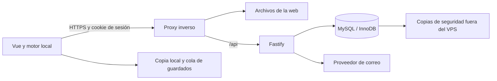

# 21 · Cuentas de usuario, mazos y campañas en MySQL

**Fecha:** 19 de octubre de 2026.  
**Estado:** informe previo a implementación. No se han programado cuentas, API de persistencia ni migraciones.  
**Decisión del propietario:** despliegue en un VPS y base de datos **MySQL**.  
**Pendiente:** registro abierto o por invitación; correo y contraseña, Google o ambos.

## 1. Propuesta

Añadir una cuenta con una biblioteca privada de mazos y campañas, accesible desde distintos dispositivos. Mantener el motor ejecutándose en el navegador y guardar en el servidor los progresos completos. Esto cubre el objetivo solicitado sin convertirlo en un proyecto de multijugador.

Conservar el juego como invitado y la exportación a archivo como respaldo es una **recomendación pendiente de confirmar**. El primer inicio de sesión ofrecería importar los datos locales, con vista previa y sin sobrescribir la biblioteca de la cuenta.

Para el acceso, propongo inicialmente correo y contraseña con verificación y recuperación por correo, sujeto a la elección del propietario. Si se elige Google, habrá que incorporar OpenID Connect y revisar su documentación oficial antes de implementar ese flujo. Ninguna opción requiere usar cuentas o servicios de autenticación del proyecto de referencia.

## 2. Estado real del proyecto

| Pieza revisada | Estado | Trabajo necesario |
| --- | --- | --- |
| `apps/web/src/stores/decks.ts` | Mazos en `localStorage`, clave `lcg:decks`; recompensas en `lcg:rewards` | Repositorio remoto, validación de datos locales, aislamiento por cuenta y migración |
| `apps/web/src/stores/game.ts` | Una campaña y una sesión activas; guardado después de cambios | Biblioteca de múltiples campañas con identificador propio y sincronización |
| `apps/web/src/game/session.ts` | Formato `lcg-session` v1, validación, historial, copia de respaldo y recuperación | Extraer formato y validadores para compartirlos con el servidor |
| `Session` | Incluye `state`, `history`, `campaign`, versión de contenido y `advanceReview` | Conservar el conjunto para reanudar sin perder deshacer ni lecturas pendientes |
| `apps/server/src/app.ts` | Fastify con salud y WebSocket de demostración | Autenticación, autorización y API HTTP de bibliotecas |
| `apps/server/package.json` | Sin conector SQL ni librería de autenticación | Seleccionar e incorporar dependencias compatibles al implementar |
| `docker-compose.yml` y `.env.example` | Proponen PostgreSQL 17, sin persistencia SQL implementada en la API | Sustituir la configuración por MySQL; no hay una migración de datos SQL de aplicación que ejecutar |
| `packages/cards/src/decks.ts` | Tipos y validación de reglas de mazos reutilizables | Permitir guardar borradores y exigir validez al empezar una campaña |
| `apps/web/src/router.ts` | Portada, mesa, campaña y mazos; sin rutas de cuenta | Añadir acceso, recuperación, perfil y biblioteca |
| `packages/shared/src/index.ts` | Protocolo WebSocket y tipos básicos | Contratos HTTP, errores y metadatos de revisión |

La arquitectura de [04](04-arquitectura-propuesta.md) describe un servidor de juego futuro. No refleja el funcionamiento local actual. Para este trabajo, su apartado de PostgreSQL queda sustituido por la decisión de MySQL y el motor puede seguir en el cliente.

## 3. Alcance de la primera versión

- Crear cuenta, verificar correo, iniciar y cerrar sesión, recuperar contraseña y consultar el perfil, si se confirma el acceso con contraseña.
- Biblioteca privada de múltiples mazos: crear, editar, renombrar, duplicar y eliminar. Mantener la importación existente de ArkhamDB.
- Biblioteca privada de campañas y escenarios independientes: nueva aventura, continuar, renombrar, archivar y eliminar.
- Guardar la campaña entre escenarios y la partida dentro de un escenario: decisiones, experiencia, trauma, mazos de campaña, bolsa, estado de mesa e historial.
- Recuperar los datos desde otro dispositivo después de confirmar su guardado en el servidor.
- Mostrar estados de sincronización y conservar una copia local ante cortes de red.
- Migrar con confirmación los datos actuales del navegador a una cuenta.
- Exportar datos y eliminar la cuenta con tratamiento explícito de sus copias y sesiones.

Quedan fuera de esta versión el juego simultáneo entre usuarios, campañas compartidas, publicación de mazos, chat, clasificaciones y edición colaborativa. Una campaña tiene un propietario que controla sus investigadores.

## 4. Arquitectura en el VPS

Servir web y API desde el mismo dominio simplifica las cookies y la configuración de origen. El proxy termina HTTPS; Fastify y MySQL no necesitan puertos públicos. Si MySQL está en otra máquina, conectar por red privada o TLS con acceso restringido.

Propuesta de base: MySQL 8.4 con InnoDB y `utf8mb4`, usando un parche soportado al desplegar. Primero hay que confirmar la versión disponible y si el VPS ya tiene MySQL y otras aplicaciones; no se sustituirá una instalación existente sin estudiar sus dependencias. MySQL admite columnas JSON y transacciones InnoDB, adecuadas para combinar metadatos relacionales y estados del juego. [Documentación de JSON](https://dev.mysql.com/doc/refman/8.4/en/json.html), [transacciones InnoDB](https://dev.mysql.com/doc/refman/8.4/en/innodb-transaction-model.html).

Para acceso SQL propongo `mysql2` con consultas parametrizadas y migraciones SQL versionadas. Es una elección de diseño a validar por compatibilidad y mantenimiento antes de instalarla. El usuario de ejecución tendrá permisos de aplicación; las migraciones usarán credenciales separadas. No hace falta Redis inicialmente.

## 5. Modelo de datos propuesto

Identificadores UUID, fechas UTC con precisión suficiente y claves foráneas con índices. Las fechas y la propiedad de los objetos las establece el servidor.

| Tabla | Datos principales |
| --- | --- |
| `users` | `id`, correo original y normalizado único, nombre visible, idioma, estado de verificación, fechas |
| `password_credentials` | `user_id`, hash de contraseña y fecha de cambio; solo si hay acceso con contraseña |
| `auth_sessions` | Hash de token opaco, usuario, creación, último uso, caducidad y revocación |
| `account_tokens` | Hash, usuario, propósito de verificación o recuperación, vencimiento y consumo |
| `decks` | `id`, `owner_id`, nombre, investigador, lista de cartas JSON, origen, `revision`, fechas y borrado lógico |
| `campaign_saves` | `id`, `owner_id`, nombre, identificador de contenido, dificultad, estado, escenario actual, `revision`, fechas y archivo/borrado |
| `campaign_save_revisions` | Campaña, revisión, paquete `Session` JSON, versión del formato/motor/reglas/contenido, tamaño, identificador de operación y fecha |
| `user_rewards` | Recompensas desbloqueadas por usuario, incluida procedencia de importación cuando se conozca |
| `local_imports` | Usuario, identificador de importación local, resultado y correspondencia entre identificadores locales/remotos |

`campaign_saves` representa **una aventura concreta del usuario**. Su `id` es distinto de `brethren-of-ash`, que identifica contenido y puede repetirse en muchas aventuras. El paquete JSON completo es el guardado canónico; los metadatos para listar se derivan de él al escribir y se actualizan en la misma transacción.

Conservar unas pocas revisiones recientes permite recuperarse de guardados erróneos. Retención, cuota y frecuencia se medirán antes de fijar cifras: el historial puede crecer mucho. No duplicar indefinidamente el paquete completo por cada acción.

Índices iniciales: correo normalizado único; bibliotecas por propietario y fecha; revisiones únicas por campaña y número; hash de sesión único y caducidad; operaciones de guardado únicas dentro de cada campaña para evitar duplicados. No indexar todo el JSON por defecto. Los límites de cuerpo HTTP, proxy y `max_allowed_packet` deben concordar.

Los mazos de los investigadores ya están copiados dentro de la campaña. Editar o borrar un mazo de la biblioteca no debe modificar una aventura empezada. Sus mejoras se guardan dentro del paquete de campaña.

## 6. Autenticación y separación entre usuarios

La opción de correo y contraseña requiere hash Argon2id con sal, parámetros medidos en el VPS y posibilidad de actualizar el hash al entrar. No se guardarán contraseñas recuperables. Es la familia recomendada por [OWASP para almacenamiento de contraseñas](https://cheatsheetseries.owasp.org/cheatsheets/Password_Storage_Cheat_Sheet.html).

Usar una cookie `HttpOnly`, `Secure`, `SameSite=Lax`, ruta `/`, con token de sesión aleatorio opaco y hash almacenado en servidor. Rotar al autenticar; aplicar vencimiento absoluto y por inactividad; revocar al cerrar sesión o recuperar la contraseña. No guardar credenciales de sesión en `localStorage`. Estas decisiones siguen la [guía de sesiones de OWASP](https://cheatsheetseries.owasp.org/cheatsheets/Session_Management_Cheat_Sheet.html).

Las operaciones de escritura llevarán protección CSRF, comprobación de origen y tipos de contenido permitidos. `SameSite` no sustituye esa protección. [Prevención CSRF](https://cheatsheetseries.owasp.org/cheatsheets/Cross-Site_Request_Forgery_Prevention_Cheat_Sheet.html).

Los enlaces de verificación y recuperación tendrán tokens aleatorios de un uso, vencimiento y límites de envío. La recuperación responderá sin revelar si existe una cuenta, no iniciará sesión automáticamente y permitirá revocar sesiones anteriores. [Recuperación de contraseña](https://cheatsheetseries.owasp.org/cheatsheets/Forgot_Password_Cheat_Sheet.html).

Toda consulta o modificación de un mazo o campaña filtrará por el usuario autenticado. Un UUID no es autorización. `owner_id` nunca se aceptará del cliente. Probar expresamente que A no puede leer, actualizar, exportar ni borrar recursos de B, tampoco sus revisiones.

Aplicar límites de peticiones a acceso, registro, recuperación, importación y guardados; ocultar cookies, tokens y contraseñas en logs; limitar tamaños y profundidades JSON. Validar entradas y respuestas con esquemas de Fastify para no devolver campos privados por accidente. [Validación y serialización en Fastify](https://fastify.dev/docs/latest/Reference/Validation-and-Serialization/).

Si se decide Google, añadir una tabla de identidades por emisor y sujeto; la vinculación de identidades exigirá prueba de control y no se resolverá únicamente porque coincida el correo. El flujo completo se detallará después de elegirlo.

## 7. API HTTP prevista

| Grupo | Operaciones |
| --- | --- |
| Cuenta con contraseña | `POST /api/auth/register`, `/login`, `/logout`, `/verify-email`, `/resend-verification`, `/forgot-password`, `/reset-password`; `GET /api/auth/me` |
| Perfil | `PATCH /api/me`, `POST /api/me/change-password`, `GET /api/me/export`, `DELETE /api/me` |
| Mazos | `GET/POST /api/decks`; `GET/PATCH/DELETE /api/decks/:id` |
| Campañas | `GET/POST /api/campaigns`; `GET/PATCH/DELETE /api/campaigns/:id` |
| Guardados | `GET/PUT /api/campaigns/:id/save`; listado y recuperación de revisiones del propietario |
| Migración | `POST /api/imports/local`, idempotente y con correspondencia de identificadores |

Las listas estarán paginadas y devolverán metadatos, sin cargar todos los historiales. Los errores tendrán códigos estables traducibles: autenticación requerida, validación, conflicto, versión incompatible, cuota y fallo temporal. Responder `404` para recursos ajenos; `409` para revisión desactualizada; `413` si se supera tamaño; `429` ante exceso de peticiones.

Guardar un mazo incompleto debe ser posible como borrador. Guardar un paquete de campaña exige validación estructural y de compatibilidad. Esta primera versión admite el progreso del cliente como dato personal; no certifica que se haya jugado sin alteraciones. La verificación autoritativa del motor sería otro alcance.

## 8. Guardado, varios dispositivos y fallos de red

1. Cada cambio estable del juego se conserva primero en almacenamiento local duradero. Propongo IndexedDB para paquetes e historial, con claves por usuario y campaña. También se persiste la cola pendiente.
2. Una cola por campaña agrupa cambios brevemente y envía una instantánea coherente del estado más reciente. Solo habrá una escritura en vuelo por campaña desde cada cliente.
3. El cliente envía la revisión base y un identificador único de operación. El servidor verifica usuario, esquema, versiones y límites.
4. En una transacción, una actualización condicional por propietario y revisión publica el nuevo guardado e incrementa `revision`; se inserta su versión y se aplican límites de retención. Cero filas actualizadas significa conflicto, no permiso para sobrescribir.
5. Un reintento con el mismo identificador devuelve el resultado anterior. El cliente solo marca como confirmada la versión enviada; los cambios posteriores siguen pendientes.
6. Al abrir en otro dispositivo se descarga la última revisión confirmada. Si hay trabajo local pendiente, se compara antes de cargar o enviar.
7. Si dos pestañas o dispositivos avanzan por separado, detener el envío automático y ofrecer conservar la versión remota, recuperar/exportar la local o crear otra aventura con ella. No intentar fusionar decisiones del motor.

La interfaz distinguirá «Guardado en este dispositivo», «Guardando en tu cuenta», «Guardado en tu cuenta», «Sin conexión» y «Conflicto». Un fallo de red no expulsará de la partida ni simulará éxito remoto. Un `401` conserva el trabajo local y pide volver a entrar.

No depender de `beforeunload` para guardar: cerrar el navegador puede interrumpir una petición. La copia local permite reintentar al volver. Esto conserva partidas ante cortes, pero **no promete cargar la aplicación desde cero sin conexión**; una PWA con caché de recursos requeriría trabajo adicional.

## 9. Migrar sin perder las partidas actuales

Antes de modificar los stores, crear una exportación de seguridad. En el primer acceso, detectar `lcg:decks`, `lcg:rewards` y la sesión v1 del navegador, incluidos estados entre escenarios y las lecturas `advanceReview` pendientes.

Mostrar qué se importará y a qué cuenta. El propietario elige; iniciar sesión no convierte automáticamente datos de un navegador compartido en datos de su cuenta. Validar los mazos locales, que hoy se cargan mediante conversión de tipo sin un esquema completo.

Importar con identificador idempotente: repetir por corte de red no debe crear duplicados. Conservar los originales hasta confirmar y verificar la copia remota. Si se divide una importación grande en lotes, registrar cada lote y permitir reanudarlo sin declarar éxito global prematuro.

Al cerrar sesión o cambiar de usuario, vaciar la memoria de los stores y bloquear la sincronización de la cuenta anterior. Nunca subir su cola pendiente a otra cuenta. Las copias locales pendientes seguirán segregadas y se ofrecerá exportarlas o eliminarlas del dispositivo; no mezclarlas con el modo invitado. El almacenamiento local no proporciona confidencialidad frente a otra persona con acceso al mismo perfil del navegador: el flujo de cierre debe explicarlo.

Las recompensas pasarán a estar asociadas a cada usuario. Perder `lcg:rewards` al migrar invalidaría mazos que hoy son utilizables.

## 10. Compatibilidad y cambios de código previstos

- Crear un paquete sin Vue ni acceso obligatorio a navegador para el formato `Session`, tipos y validadores. Separar lectura/escritura local de la validación pura y revisar sus dependencias con `@lcg/cards` y `@lcg/engine`.
- Mantener historial y `advanceReview`; guardar `latest` del store, no el estado visual que puede quedar retrasado durante una animación.
- Añadir `saveId` y repositorios local/remoto a los stores; dejar de tratar «campaña activa» como la única aventura existente.
- Cambiar rutas de biblioteca y carga para seleccionar un guardado concreto antes de entrar en `/game` o `/campaign`.
- Incorporar cliente HTTP, estado de usuario y cola de sincronización, con contratos en `packages/shared`.
- Añadir módulos de servidor para acceso, bibliotecas, validación, SQL y correo, con migraciones versionadas.
- Actualizar Compose, variables de ejemplo y documentación a MySQL; incorporar el servicio de base de datos a CI.

Una versión de formato y una versión de reglas no son equivalentes. El validador actual rechaza versiones de motor/reglas incompatibles y `CONTENT_VERSION` conserva un nombre centrado en Brethren. Hay que definir una política explícita: migrar solo formatos conocidos, rechazar con explicación los incompatibles, conservarlos exportables y nunca «actualizar» un guardado cambiando su etiqueta. Importar un archivo antiguo no garantiza que pueda ejecutarse con reglas nuevas.

## 11. Pasos de implementación y aceptación

| Fase | Entregable | Criterio de aceptación |
| --- | --- | --- |
| 0. Decisiones | Registro, acceso, dominio, MySQL y correo confirmados | Alcance aprobado antes de implementar |
| 1. Persistencia común | Formato compartido, contratos y adaptador local | Exportaciones actuales se cargan sin perder historial ni lecturas |
| 2. Infraestructura | MySQL en desarrollo/CI, migraciones y repositorios | Instalación limpia y actualización repetible; consultas parametrizadas |
| 3. Cuentas | Registro/acceso según método acordado, recuperación y cierre | Sesiones revocables y pruebas de expiración, abuso y aislamiento |
| 4. Mazos | Biblioteca remota y recompensas por cuenta | Guardar en A y recuperar en B; borradores permitidos; cuentas aisladas |
| 5. Campañas | Biblioteca y guardados con revisión | Dos aventuras de la misma campaña conservan progresos independientes |
| 6. Migración y red | Importación local y cola duradera | Reintentos sin duplicados; no pérdida ante desconexión; conflictos visibles |
| 7. Despliegue | Entorno de prueba en VPS y copia recuperable | Restauración probada y recorrido completo en ordenador y móvil |

Las fases se entregarán en PR pequeñas. Primero base y pruebas, después integración de interfaz y despliegue. No hace falta trasladar el motor al servidor ni activar el WebSocket de partidas para completarlas.

## 12. Pruebas necesarias

- Integración contra MySQL real de la versión elegida, no únicamente mocks: restricciones, transacciones, revisiones concurrentes e idempotencia.
- Registro duplicado, correo sin verificar, enlaces consumidos o vencidos, recuperación y revocación; accesos Google si se eligen.
- Usuario A intentando todos los accesos por ID a mazos, campañas y revisiones de B.
- Dos sesiones guardando sobre la misma revisión: una confirma y la otra recibe conflicto.
- Migración de datos válidos, corruptos, recompensas, guardados entre escenarios y paquetes incompatibles.
- Pérdida de red después de que el servidor confirme pero antes de que el cliente reciba la respuesta.
- Cierre de pestaña con pendientes, cambio de cuenta, cierre de sesión y borrado de cuenta.
- Reanudar Brethren y La Gala con el mismo estado, RNG, historial, selección pendiente y lectura de actos.
- Interfaz accesible: etiquetas, errores asociados, foco, navegación por teclado y anuncios de sincronización discretos; EN/ES y móvil.
- Restaurar una copia de seguridad en una base vacía y verificar campañas y cuentas recuperadas.

## 13. Operación y dimensionamiento

El despliegue necesita dominio y HTTPS, MySQL, aplicación Node, almacenamiento persistente y correo transaccional. Las credenciales irán en secretos del VPS; GitHub solo contendrá ejemplos. Si ya existe MySQL, crear base y usuarios propios sin modificar bases ajenas.

Configurar copias cifradas fuera del VPS, rotación, alertas de error y una restauración de prueba. Objetivo inicial propuesto: copia diaria y recuperación ensayada; el propietario debe aceptar que una copia diaria puede perder hasta un día de guardados remotos ante desastre. Si exige menos pérdida, añadir recuperación a un punto en el tiempo y retención de binlogs antes del lanzamiento.

Registrar tiempos de guardado, fallos, conflictos, crecimiento de datos y disponibilidad, sin incluir paquetes de partida ni secretos en logs. Añadir comprobación de disponibilidad de la base y apagado ordenado del servidor.

Presupuesto y capacidad dependen del VPS y de los usuarios: medir tamaño real de guardados de Brethren y La Gala, frecuencia de escritura y revisiones retenidas. Fórmula inicial: usuarios × campañas medias × tamaño de paquete × revisiones conservadas, más índices, copias y margen. No se han presupuestado ni contratado servicios.

Para borrar una cuenta: reautenticar, revocar sesiones, eliminar datos activos y pendientes de envío, y documentar cuándo caducan sus copias de respaldo. Antes de abrir registros hay que definir responsable, política de privacidad y retención aplicable al despliegue; este informe no es un análisis jurídico.

## 14. Decisiones pendientes

1. **Registro abierto con verificación o solo por invitación.** Define el flujo de altas y el control de abuso.
2. **Correo y contraseña, Google o ambos.** Recomendación inicial: correo y contraseña con verificación y recuperación; Google puede incorporarse después si interesa.
3. **Invitado.** Recomiendo conservarlo y ofrecer cuenta para sincronizar, sin exigir registro para probar el juego.
4. **Datos del VPS.** Dominio, sistema operativo, recursos y versión/ubicación de MySQL; confirmar si hay servicios existentes. Se pueden facilitar después, sin enviar contraseñas en el chat.
5. **Correo transaccional.** Disponibilidad de SMTP o elección de proveedor para altas y recuperación; no contratarlo todavía.
6. **Retención y uso previsto.** Usuarios aproximados, política de revisiones y pérdida de datos admisible ante desastre.

Se puede cerrar el diseño sin credenciales. Para comenzar la implementación hace falta resolver, como mínimo, las elecciones de registro y acceso. El VPS y MySQL ya están confirmados.
